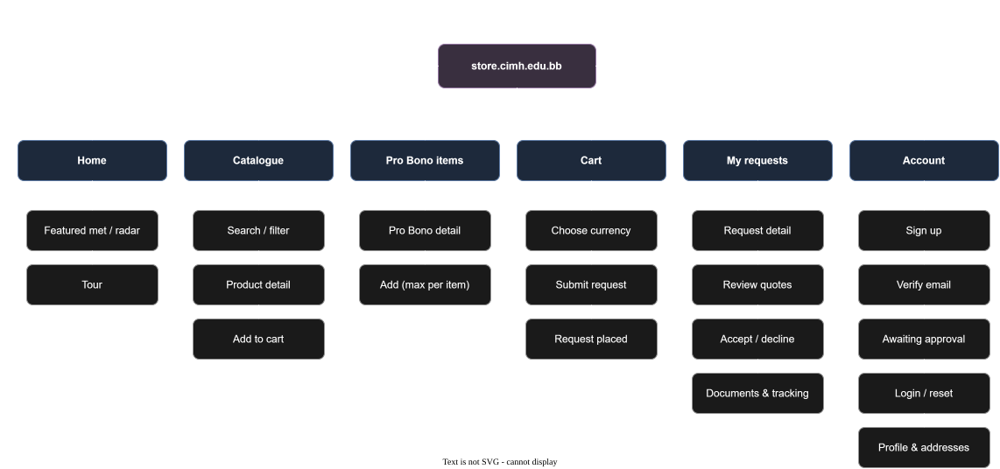
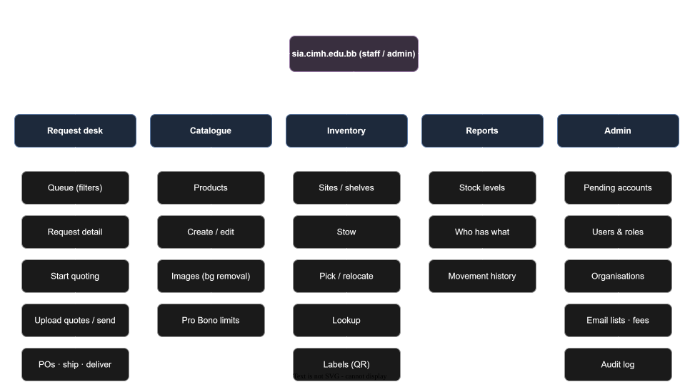
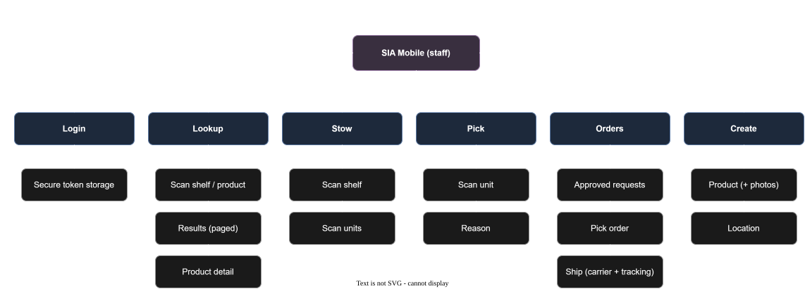
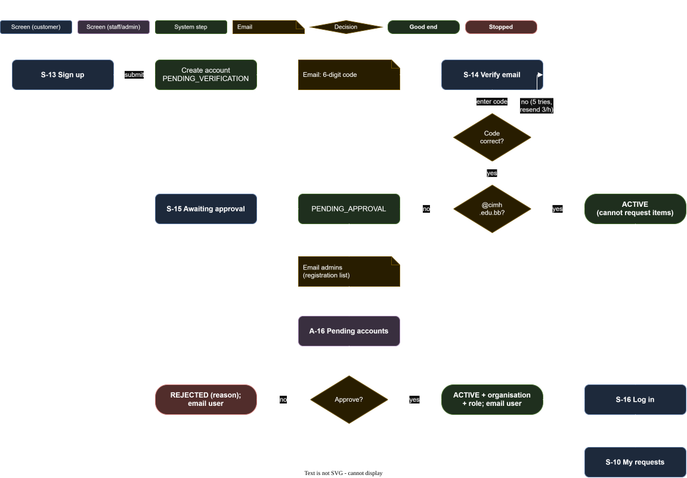
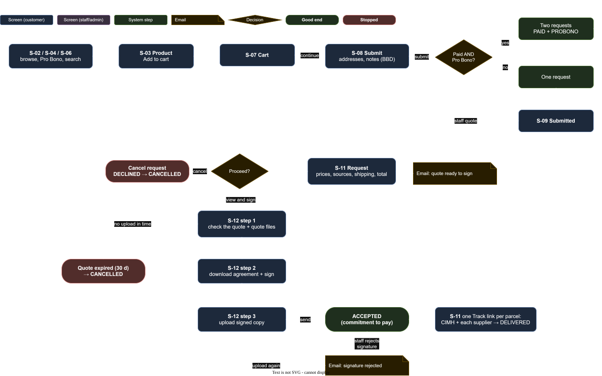
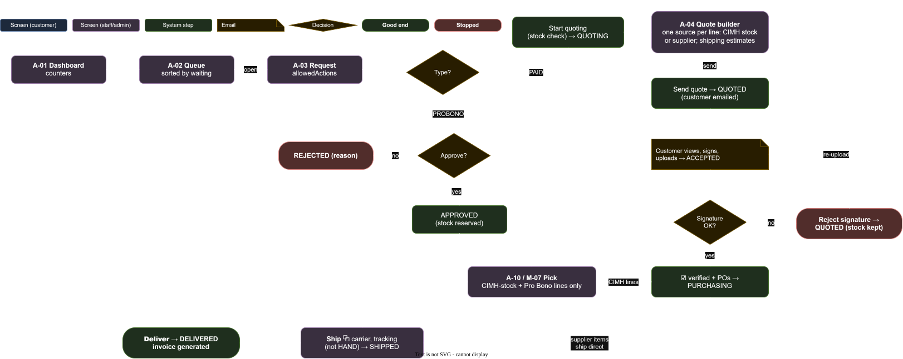
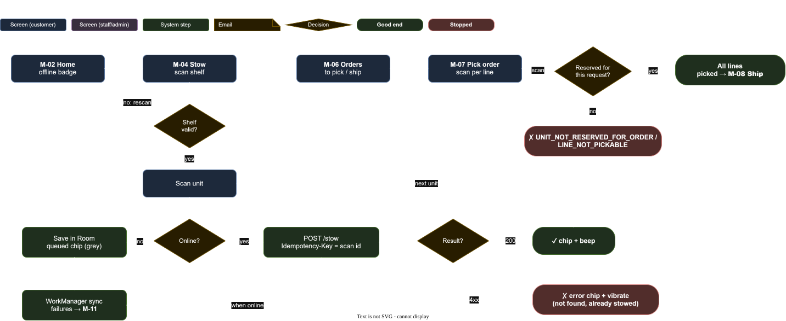

# App Flow Document (APD): CIMH Stores Platform v2

| | |
|---|---|
| **Document status** | DRAFT |
| **Document owner** | T. Edwards |
| **Related documents** | [PRD](PRD.md) · [TAD](TAD.md) · [BSD](BSD.md) · [API](api/README.md) · Design Brief (planned) · [Manual](manual/index.html) |
| **Last updated** | 2026-11-06 |

---

## 1. Purpose and conventions

Shows **what happens when someone clicks and which page comes next**, for SHOP, SIA and SIA Mobile, and maps the main user journeys. It is the shared map for design, frontend, mobile and QA. Visual design is in the Design Brief; endpoints are in the [API](api/README.md).

| Convention | Meaning |
|---|---|
| Screen ids | `S-nn` SHOP · `A-nn` SIA · `M-nn` Mobile · `J-nn` journeys |
| Routes | **File-based routing**: the route equals the file under `src/pages/` (e.g. `/requests/[id]` = `src/pages/requests/[id].vue`). Mobile uses Compose navigation route names |
| Guards | `public` · `auth` (any ACTIVE account) · `customer` (role user, **not** `@cimh.edu.bb`) · `staff` (staff or admin) · `admin` |
| Buttons from data | Request actions are shown **only** if listed in `Request.allowedActions` (API). Screens never re-implement the status rules |
| "→" | Navigates to · "↺" stays on the screen and refreshes · "⧉" opens a dialog |

## 2. Global behaviour (all apps)

| Situation | Behaviour |
|---|---|
| Not logged in on a guarded route | → Login with `?returnTo=<route>`; after login, return there |
| Login with a non-ACTIVE account | `ACCOUNT_PENDING_VERIFICATION` → Verify email · `ACCOUNT_PENDING_APPROVAL` → "Awaiting approval" · `ACCOUNT_REJECTED` / `ACCOUNT_SUSPENDED` → message with a contact link · `ACCOUNT_LOCKED` → "Too many failed attempts. Try again in n minutes." (from `Retry-After`; shown since 2026-11-25) · `MFA_REQUIRED` → code step · on the code step `MFA_INVALID` → "That code is not valid", `MFA_CODE_REUSED` → "That code was just used. Wait for the next code" (field cleared; also on MFA setup) |
| Role not allowed (e.g. customer opens SIA) | SIA/Mobile: "This app is for CIMH staff" + link to SHOP. SHOP staff-only pages don't exist |
| Staff opens an admin-only page (SIA) | → dashboard with a toast naming the page: "“Audit log” is for administrators only. Ask an administrator if you need something there." (no silent jump) |
| Record ids on screen (SIA) | An order id shows **in full wherever its place has room** (web-app `ShortRef`, the default since 2026-11-25, owner: never cut when the whole id fits; re-checked when the width changes), otherwise a short reference (`shortRef`: `ORD…3f9a2c`, the last six characters) with the full id on hover; product ids on the product list stay short. The record's own header shows the full id with Copy. Meanings are never only in a tooltip (Held legend on A-13; full unit codes on unit cards, Pick Order lines and Who has what) |
| `@cimh.edu.bb` user in SHOP | Can browse. Cart icon hidden; "Add to request" replaced by a note: "CIMH staff can't submit requests" |
| Session expired mid-use | Silent refresh. If refresh fails → Login (`returnTo`), and unsaved form data is kept in session storage |
| 404 / not visible | "Not found" page with a link back (hidden resources look the same as missing ones) |
| 409 version conflict | Toast: "This was changed by someone else", then ↺ reload. The user's draft is kept where possible |
| 422 validation | Inline field errors from `errors[]` |
| 429 | Toast with the `Retry-After` countdown |
| 503 / network | Banner "Service unavailable, try again" + Retry. Nothing was saved |
| Empty lists | Explanatory empty state with the next action (e.g. "No requests yet → Browse catalogue") |
| Loading | Skeletons for lists and detail; buttons show a spinner and are disabled while submitting |
| Incomplete forms | Submit buttons are **not** disabled for missing input: pressing one marks every missing or wrong field and puts the cursor in the first (`checkForm`). A save button is disabled only when nothing has changed, and the save bar says so. Exception: small dialogs whose single field carries the hint (reason dialogs; Erase account, where typing the email is the safeguard) |
| Actions that can't be undone, or that email someone | Ask first in a dialog that names the record and what happens (send quote, return a unit, remove an address, erase, merge). The safe button is named for what it keeps ("Keep editing", "Keep issued") |
| Narrow screens (SIA) | No page scrolls sideways at 360 px; tab strips and chip rows scroll in place and keep the active tab on screen. Tables that would clip become stacked entries: the request timeline in narrow panels, quote-builder lines (two rows below 900 px of panel, cards below 600; laid out by panel width, not window width). Long lists are capped: the dashboard queue shows 10 on phones with a link to the desk, the Places tree 40 sites with "Show all" (the open site always listed). A record opened "beside" a list (`?open=`) goes to its own page on narrow screens. Emails keep their domain whole; only the part before @ is shortened |
| Theme | Light/dark toggle, remembered per device |
| Announcements (SHOP + SIA) | Admin messages (A-22) at the very top of every page, above the app bar and drawer (a layout slot, nothing covered): SHOP for everyone incl. signed-out visitors and sign-in pages, SIA for signed-in staff. Up to 3 rows, alerts first, more behind "n more". Each row: icon + word (Information / Alert) + text (2 lines, More) + optional link (a product opens its page in this app: SHOP `/catalogue/<id>`, SIA `/products/<id>`; a web address opens a new tab) + Close on information only (remembered in the browser until the message is edited). Arrives and leaves live (WebSocket; polling every 2 min if sockets fail); a reload shows it at once. New messages are read out by screen readers (alerts assertively). |

## 3. SHOP: screens

**Outstanding payments at sign-in** (owner, 2026-11-23): when a customer signs in with delivered paid requests still waiting for a proof of payment, a dialog lists each (what, short ref, delivery date, agreed total; a row opens S-11) with **Continue** and **Go to orders** (→ S-10 `?status=payment`); once per account per tab session. Plain head since 2026-11-24 (golden-ratio dialogs, Design Brief): "Payment due" + "On n delivered requests" beside **Total owed**; the same for **Send proof of payment** (request · ref beside **Amount**) and S-12's **Send the signed agreement?** (beside **Total to sign**).

**Top bar:** logo → S-01 · Catalogue · Pro Bono · search box → S-06 · Cart (badge; customers, and visitors who are sent to log in first; not CIMH accounts) → S-07 · **Orders** → S-10 (page name "Orders", owner 2026-11-16) · Account menu (Profile, Log out) or Log in / Sign up.

| ID | Route | Screen | Guard | Main content | Actions → next |
|---|---|---|---|---|---|
| S-01 | `/` | Home | public | Hero carousel (the only large headline; no auto-advance, arrows + dots); **institute masthead** (deep navy field, white CIMH crest, one line on what the store is, the visitor's next step: Sign up / Log in, or Orders / catalogue); **Find your equipment**: a photo tile per equipment family that has items (radar large; two or three real item names, no counts; a failed tile shows **Retry**) and a yellow Pro Bono tile; **How requesting works** (4 steps on one path: approved account → request without prices → quote valid 30 days → signed agreement and delivery, drawn once on first view) with the Pro Bono branch (no quote); folded to one line for signed-in customers. Phones: one-column family rows with thumbnails, steps down the left edge | Family → S-02 (filtered) · Whole catalogue → S-02 · Pro Bono → S-04 · Sign up → S-13 · My requests → S-10 |
| S-02 | `/catalogue` | Catalogue | public | Search desk: navy band with title, one wide search (make, model or model number; matches marked in results), family index (All · Meteorological · Radar: SHOP shows only MET and RAD plus Pro Bono of any type), In stock only, Filters (department, project); same-height cards (photo on a white plate, or the part's nameplate), "Load more" (cursor) | Product → S-03 · Search → S-06 |
| S-03 | `/catalogue/[id]` | Product detail | public | Images, specs, availability (**no price**), Pro Bono badge and max per request, "How requesting works" (folded). **No photos:** no photo area; name, make/model, description and details take the main column | Quantity + **Add to cart** (customer) ↺ cart badge, toast "Added … to your cart" with "View cart" → S-07 · Not logged in → **Log in to request** S-16 (`returnTo`) or Register → S-13 |
| S-04 | `/pro-bono` | Pro Bono items | public | Same as S-02 (yellow rule and badge), filtered to `probono=true`; the index lists projects | → S-03 |
| S-06 | `/search?q=` | Search results | public | Ranked results, filters | → S-03 |
| S-07 | `/cart` | Cart | customer | Lines (snapshot, qty stepper with a typed quantity (0 removes), remove) under "Items to be quoted"; Pro Bono lines grouped separately; notes: "Paid and Pro Bono items become two requests", "Nothing is paid here". Layout "Progress rule" (2026-11-16): navy band with the request path Cart → Invoice → Delivery → Sent as four nodes on one rule that fills as the customer goes (done nodes go back), one question per screen under it; step 1 = lines beside a request slip | Qty change ↺ · Remove ↺ · **Continue to invoice** → S-08 · Add more items / Empty → S-02 |
| S-08 | `/cart` (steps 2–3) | Submit request | customer | Step **Invoice** ("Who is the quote made out to?"): invoice address as tiles (every saved address, or a new one). **A new address is saved to the account** (`PATCH /me`, max 10; an identical one is just picked; full list or a failed save = used for this request only) and is offered in later requests and in Account. **No currency question**: every quote is in BBD (owner, 2026-11-16). Step **Delivery** ("Where should it go?"): tiles "The invoice address" / "Another address" (then saved addresses + new), notes; beside it a "Check before you send" sheet (navy head with the item count; items as a table (#, item with make · model, model no., qty; group rows "To be quoted" and "Pro Bono · Free"; Total), the address column narrow and the sheet wide, invoice and delivery addresses as address blocks, each part with Change back to its step; quote in BBD, the note; "not a commitment to pay"; **Send request** at its foot) | **Send request** → S-09 · Back → S-07 · Continue / Submit without an address → the missing address is named beside it |
| S-09 | `/cart` (step 4) | Request submitted | customer | One or two request ids, "What happens next" | View request → S-11 · Continue browsing → S-02 |
| S-10 | `/requests` | Orders | customer | **Docket** (2026-11-16): navy band with the title and tabs **Mine / My organisation**; list grouped by whose move it is with counts: **Waiting for you** (own requests with a quote to review or an agreement to sign, "valid until" + days left), With CIMH, On its way, Done; rows titled by what was requested (first item "and n more"), state + sent date, the id (in full when it fits), Pro Bono / Payment required badges at the right edge of the title line (owner 2026-11-25). Filters status, year (only once there is something to filter). **Wide screens (≥ 1100 px): the open request beside the list** (`?open=<id>`, default = first waiting, else newest); narrower: rows open S-11. Empty with filters set → **Clear filters**. **Payment required** (owner, 2026-11-23): a delivered PAID request with no proof of payment sits under Waiting for you with a "Payment required" badge and "Delivered · payment required"; the status filter has **Payment required** (`payment=due`; `?status=payment` opens on it) | Row → S-11 (beside, or own page) |
| S-11 | `/requests/[id]` | Request detail | customer (owner or same org) | Shared `RequestSheet` (also beside the S-10 list). Short ref (full id in its tooltip) + sent date, title = what was requested, status chip; **request path** (Sent · Quote · Signed · Ordered · Shipped · Delivered; Pro Bono: Sent · Approved · Picking · Shipped · Delivered) filled to where it stands (hidden once closed); **whose-move well** (customer's turn = primary tone + action and quote expiry; waiting on CIMH = neutral; amber when the quote expires within 7 days; green accepted/delivered; red closed). "View and sign" (2026-11-17): while QUOTED the well says "Your quote is ready: BBD total" and what the agreement is (every item, where it comes from, its price; someone who can commit the organisation signs it; the signed copy comes back here), with **View and sign** (after a rejected signature: **Send it again** → S-12 `?task=send`) and, under the expiry, **Already signed? Send the signed copy →** (S-12 `?task=send`, for whoever comes back only with the signed copy) (View and sign has a soft primary halo and a ring every 2 s until the customer first presses it for this quote version, remembered in the browser; hover or focus pauses the ring; reduced motion = the halo only) and **Cancel request** (the server's `decline`) 16 px under it; after a rejected signature it says why and asks for a new copy; a quote sent before the change (no agreement) reads "CIMH is updating the quote". **One of each** (critique fix, 2026-11-18): **while the requester's quote waits the page is a hand-off with no prices** (the total once, in the well; the priced quote is read on S-12); a same-org viewer or a quote still waiting for its agreement sees the shared `QuoteTable` first (one row per item with where it comes from — CIMH stock or the supplier that ships it directly — unit price and total; estimated shipping per source; admin fee; the total named by state: **Total to sign** while QUOTED, **Agreed total** once signed, **Quoted total** on a closed request; the agreement PDF also says "Total to sign"); later the quote is a record after the items. Then Items (source per line once quoted; Pro Bono items marked Free, also on an all-Pro-Bono request), Delivery (address with the country by name; currency only on a legacy USD request; then **one row per shipment** (2026-11-19): who sent it — "Sent by CIMH" or "Sent directly by <supplier>" — carrier · date · note · **Track <number> ↗** on one line, then its items as "name × qty", and while lines are left a "Not shipped yet" row naming them) as ruled sections with h2 heads (h3 beside the S-10 list), and **History** folded at the end (dated changes in the path's words, reasons included; the status timeline is gone, so there is one progress model); a closed or rejected request gives its reason in the well; **no Files section and no document preview** (owner, 2026-11-18: before signing the quote files and the agreement are read on S-12; a split view and an inline preview were tried and removed); **Papers once signed** (invoices since 2026-11-24: only the current invoice / commercial invoice, named by number, "From CIMH, corrected (revision n)" after a correction; replaced and voided copies never show) (critique fix 4, owner locked "page tiles" on the decision page): from ACCEPTED on a paid request (and on a Pro Bono request once CIMH has made a paper) a ruled **Papers** section under the well shows each paper as a small A4 sheet (page 1 at thumbnail size, `DocumentThumb`, drawn when it nears the screen) with its name and kind under it: Signed agreement, Invoice (a dashed "Not yet" sheet until delivery), Agreement as sent, CIMH quote, supplier quotes of the agreed version; a tile opens the full-size reader (`DocumentReader`: a dialog, full screen below 760 px at 200 % under 600 px, Close + name + zoom + Download in one head; closing returns to the tile). Cancel request at the foot before a quote. Own page: a "← Orders" link above the request (2026-11-19: the navy band held nothing else). Once signed or closed the quote is a folded record after the items (**Quote · Agreed total BBD x**, opens in place), so items are listed once; a delivered request's well points to the invoice (Pro Bono: the delivery note) under Papers. **Payment** (owner, 2026-11-23): a delivered PAID request without a proof of payment says **Payment required: BBD total** in a red tone (error wash, red button) with **Send proof of payment** (dialog: file input, PDF/JPG/PNG/WebP ≤ 20 MB, **Send to CIMH**; uploads `payment_proof`, staff are emailed); afterwards "Proof of payment sent" with **Send another proof**; once staff mark it paid, a green **Paid** well with the date; each proof is a Papers tile. Slim footer | **View and sign** (QUOTED) → S-12 · a Papers tile → reader dialog · **Send the signed copy** → S-12 `?task=send` · **Cancel request** ⧉ reason → ↺ · **Track** (per shipment) → carrier site (new tab) |
| S-12 | `/requests/[id]/agreement` | View and sign | requester | Nothing to choose (owner, 2026-11-17). **Three tasks, open in place** (impeccable, 2026-11-18; the usual scene: read and downloaded at a desk, signed by someone else, uploaded later, often another day): navy band with a back arrow beside the title, request title · short ref · quote version, and **Total to sign** with valid until (days left; amber within 7 days). Below it a ruled list of three tasks, one open at a time, any of them reachable: **1 Check the quote** (grouped by where the items come from — "From CIMH stock, shipped by CIMH", "From <supplier>, shipped to you directly" — each group its items, qty × price and total, the supplier's USD price and rate when converted, and its estimated shipping; admin fee, **Total to sign**; ships to (organisation, town, country) and the exchange rate on legacy USD requests; at 1440 × 900 the open task 1 and the two closed tasks fit the first view), **2 Get it signed** (what the agreement commits to, who signs, where, then; **Download agreement** saves the PDF, no new tab; ↺ polling until it is made), **3 Send the signed copy** (drop or choose a scan or photo, PDF/JPG/PNG ≤ 20 MB, shown on the page before it is sent; what happens next per source; Send is never disabled: without a file it says what is missing). Each task has a node on one wire that fills as tasks are done; ticks are kept in this browser per request + quote version, a return visit opens the first task not done, `?task=check|sign|send` opens one and **the address follows the open task** (replace, so a reload or a link passed to whoever sends the signed copy opens the same task), a rejected signature opens task 3 under CIMH's reason; only what this browser saw is ticked (quote checked, agreement downloaded): **Already signed? Send the copy** opens task 3 without ticking anything. **Wide screens (≥ 1280 px)**: a 400–480 px task list, the open task's document beside it (sticky, pages drawn up to 860 px wide so the agreement's text reads at 11–14 px): the quote files (CIMH stock quote first, a tab per file) for task 1, the agreement for task 2, for task 3 the agreement until a copy is chosen (to compare the signature block), then the chosen copy; task 1 says when a supplier's own quote file is not attached; 760–1279 px, the document sits inside the open task; **phones (< 760 px)**: each document is a row (name, what it is, Read) that opens a full-screen reader at 200 % (pan inside it, Download in its head; closing returns to the row), since a page drawn at phone width reads at about 4 px. Every document has one head (its name, or a tab per file; page in view; zoom 100–300 %, phones pan sideways; Download) and lies on a darker desk ground. **Cancel request…** ends the list | Continue to the agreement → task 2 · Already signed? Send the copy → task 3 (no tick) · a task heading opens that task · **Send signed agreement** ⧉ confirm ("This accepts quote version n for BBD total; CIMH staff are emailed") → S-11 (ACCEPTED banner) · **Cancel request** ⧉ reason → S-11 · ← Request → S-11 |
| S-13 | `/signup` | Sign up | public | Three steps as tabs with a sliding indicator, panes slide in the direction of travel (You · Organisation (CIMH emails: Details) · Password; each Continue checks only its step, a server 422 jumps to the step of the first bad field); the picture lists the way to an approved account (form → email code → admin approval, usually two working days → requests). Name, email, password (strength + breach check message), organisation (free text), department, country, phone, terms | Submit → S-14 |
| S-14 | `/verify?email=` | Verify email | public | 6-digit code, resend (cool-down) | Correct → S-15 (member) or S-16 with "Account active" (`@cimh.edu.bb`) · Wrong → inline error (attempts left) |
| S-15 | `/pending-approval` | Awaiting approval | public | "An administrator will review your account; you'll get an email" | **Browse the catalogue** → S-02 · Home → S-01 |
| S-16 | `/login` | Log in | public | Email, password, (code if MFA); contact line "Trouble logging in? Write to info@cimh.edu.bb" (sign-in pages have no footer) | Success → `returnTo` or S-10 · Status errors as §2 · Forgot → S-17 · Sign up → S-13 |
| S-17 | `/forgot-password` | Forgot password | public | Email | Submit → S-18 (always, no enumeration) |
| S-18 | `/reset-password?email=` | Reset password | public | 6-digit code (six boxes, as S-14; no auto-submit) + new password | Success → S-16 "Password changed" |
| S-19 | `/account` | Your account | auth | **Account checklist** (impeccable 2026-11-16, owner's pick of three; brief `web/shop/.impeccable/surfaces/src-pages-account-vue.md`): navy band with name, email, organisation, role · status, Log out, and a checklist of where the account stands (email verified, approved by CIMH or "CIMH account", organisation linked by an administrator, saved addresses for customers, deletion requested); yellow ring = waiting on CIMH, dashed = for you. Below, one ruled row per section, read first (current values + one action): Personal details and Addresses (tiles, max 10, dashed Add tile) open in place, one at a time; Sign-in (change email, change password); Appearance (dark theme switch, this device); **Your data** (download, ask to delete). Logic: web-app `useProfile` (shared with SIA A-21) | Edit → Save details ↺ (If-Match; disabled only while nothing changed) / Cancel · Manage → Add / Edit address ⧉ · Remove address ⧉ (confirm; sent orders keep their copy) · Change email ⧉ → code step · Change password ⧉ · Download my data · Ask to delete ⧉ (password) · Log out → S-01 |
| S-20 | `/[...notFound]` | Not found | public | Message, catalogue search field, links (catalogue, Orders for customers, home); signed out: "log in to see it" with `returnTo` | → S-02 · S-10 · S-01 · S-16 |

## 4. SIA: screens (staff and admin)

**Navigation** (legacy SIA top header; drawer below 1280 px): Dashboard · **Inventory** (`/products`, the product list with the low-stock count; was "Products") · **Locations** (`/inventory`: sites, locations, shelves, labels, lookup; was "Inventory", owner 2026-11-16) · Pick · Stow · **Orders** (request desk, `/requests`; owner 2026-11-16) · Reports ▾ · Admin ▾ · Profile. The **scan box** in the header takes a unit, shelf or product code (a handheld scanner types it and presses Enter) and opens Inventory → Lookup on it; request codes open the request desk once it exists (P5).

| ID | Route | Screen | Guard | Main content | Actions → next |
|---|---|---|---|---|---|
| A-01 | `/` | Dashboard | staff | Counters: new requests, quoting, waiting for signature, signatures to check, to purchase, to pick, to ship, quotes expiring ≤ 3 days, low stock, pending approvals (admin) | Each counter → A-02 filtered / A-13 / A-16 |
| A-02 | `/requests` | Request desk (queue) | staff | Stage tabs with exact counts (one `GET /requests/counts` call, shared with the drawer and A-01; a tab seen in this visit shows its last list at once while it refreshes) (Open (open statuses + delivered paid requests not yet paid, `payment=outstanding`), New, Quoting, Waiting for signature, Signature to check, Pick & purchase, Shipped, Payment due (delivered paid requests not marked paid, proof sent or not, `payment=unpaid`; their status cell = Delivered as an icon with a tooltip + a red "Payment required" chip; owner 2026-11-23), Closed (finished, and a delivered paid request only once paid: `payment=settled`), All); search; More filters (one console panel: statuses as toggle chips in Open and Closed groups with "Only open/closed"; type, year sent (last 3 years + Earlier) and order as segmented buttons; organisation picker; Clear in the head) for statuses, type, year, organisation, sort (default **latest change first**: newest status change on top, matching the right-hand column, `sort=recent`, owner 2026-11-23; also newest sent, waiting longest, oldest); queue + detail panels like A-01 (row: id, customer/org, next step, status, waiting with overdue > 5 days) | Row selects (detail panel acts); id link / Open full request → A-03; phones: tap → A-03. Desk → A-03 is a quiet hand-off (desk fades out, the page settles 4 px; owner 2026-11-24); back from A-03 (its **Orders** link or the browser's Back) returns to the same tab and filters with the same request selected and the list shown at once |
| A-03 | `/requests/[id]` | Request (staff) | staff | Section heads (Request, Items, Quote, Shipments, Purchase orders, Files, Timeline) on the Action Wash with the title in primary, like the desk's "Selected request" head (owner 2026-11-24). On its own page the request has no outer frame: header, panels and Next step share the page edges, in line with the Orders bar above (owner 2026-11-24). Customer + org, lines (with `cimhAvailable`, From = CIMH stock or the supplier, reservation, held from the moment the quote is sent), timeline, documents, **action panel** driven by `allowedActions` While QUOTED the customer acts next, so Revise quote is an outlined (secondary) button; Pro Bono requests have no Invoiced step. **Payment** (2026-11-23): a delivered PAID request's Next step reads "Waiting for the customer to pay" or, once a proof is in, "Check the proof of payment, then mark it paid"; **Mark paid** asks first (amount, the proofs as links, optional note) → "Paid <date>". | `start-quoting` ↺ → A-04 · `send-quote` (from A-04) · **Verify agreement** (view signed PDF ⧉) → `purchase-orders` ⧉ (golden-ratio dialog 2026-11-24: plain head with Agreed total; 1 Signature: the signed copy as a file row with Open, one check "Every page is there, dated and signed by an authorised person", Reject the signature… beside it; 2 Purchase orders: a table without rules, From φ : PO number 1, CIMH stock last as "none needed") ↺ · `reject-agreement` ⧉ reason ↺ · `approve` / `reject` (Pro Bono) ↺ · **Pick** → A-10 (prefilled) · `ship` ⧉ **Record shipment** (2026-11-24 redesign; every SIA dialog now uses the golden-ratio system: 11/14/17.8/22.65 px, spacing 8·13·21·34, 8 px field corners, plain heads, like Verify and purchase: plain head with the customer, the full order id + copy and Ships to; golden-ratio dialog system, see Verify and purchase; 1 Parcel: sent from CIMH stock or one supplier, its unshipped lines ticked — CIMH lines only once every unit is picked; 2 Carrier: FedEx/DHL/UPS/Hand/Other tiles, tracking unless Hand (Hand = who delivered/collected), Other = name + https link; 3 Date and cost: ship date, **shipping cost required** (BBD, 0.00 allowed; owner 2026-11-24; the API requires it too, M-08 included), note; footer: email the customer switch; a press with something missing marks it and focuses it) ↺, repeated per parcel; the request is SHIPPED when the last line is in one · **Shipments** panel: each parcel (source, carrier, tracking link, date, cost, items) with **Correct** ⧉ (same fields, source and lines fixed, email again only on request) ↺ · `deliver` ⧉ ↺ · `cancel` ⧉ ↺ · **One invoice and one commercial invoice per request** (2026-11-24, plan `2026-11-24-invoice-crud`): the buttons read **Create invoice** while there is none, **Invoice <number>** once there is (opens it), **View invoice** once the request is marked paid; the same for the commercial invoice (shown too once one exists). Opening an existing one: title = its number, "Revision n" (+ "Made automatically from the request" for one made on delivery / for a parcel), **Earlier copies** (each revision opens in the file preview), the saved PDF on the left ("The copy the customer has.") until something changes, then the live preview ("saving issues revision n+1"); footer **Delete invoice…** (danger, apart; reason dialog: the customer no longer sees it, nobody is emailed, the number stays used) · **Email the corrected copy to** Customer / Staff (unticked) · Back · **Save changes** (only once something changed) → the next revision; the earlier PDF stays for staff. Paid = read-only, only an administrator sees **Void invoice…**. An invoice made before invoices kept their lines (LEGACY) opens with the request's lines and a note; saving gives it lines. A number already used by another invoice of the kind (voided ones included) is refused at the number field; a new invoice's number starts as the next in the series. Someone saving first: a notice with **Reload**. Next step notes a CIMH parcel leaving Barbados whose items the commercial invoice doesn't list (none is made for a second parcel). **Create invoice** / **Create commercial invoice** (2026-11-20; from ACCEPTED/APPROVED on; commercial only with CIMH-stock or Pro Bono lines) ⧉ invoice builder: live PDF preview left (legacy SIA template, marked "Preview · not sent"), panel right (redesigned 2026-11-24, owner; golden-ratio type and spacing): number + date, Billed to (Ship to on a commercial invoice), the lines as a borderless table (Item · Qty · Price · Amount, a field per cell, long items wrap; phones: item across, figures under it) from the request (every priced line; commercial = CIMH stock only) editable, removable, Add line, **Undo changes** only once a line differs from the request; a totals ledger set right (Sub-total, fees, discount, shipping cost (invoice only) typed in place, Total); footer: **Email to** Customer / Staff checkboxes beside Back + Create → stored on the request as its invoice (rev 1), emailed as ticked ↺ |
| A-04 | `/requests/[id]/quote` | Quote builder | staff | **Supplier tabs with viewer** (2026-11-17): one tab per supplier (name, currency, lines priced n/N; a dot when it needs attention) plus **CIMH stock** and **+ Add supplier**; arrow keys move between tabs. A supplier tab opens with its **terms row** (2026-11-18): a caption over each `solo-inverted` field and one message line under it (a hint; an error with an icon: a wrong value at once, a missing one only after Preview or Send was pressed): **Supplier** ("The customer sees this name"), **Their currency** BBD or USD as a segmented button (USD: staff type the supplier's USD prices; the customer sees BBD with "Supplier quote: USD x each at r BBD per USD" and the supplier's file), **Exchange rate** "1 USD = … BBD" (USD only), **Estimated shipping** (supplier to customer, in the supplier's currency; 0.00 if none), **Remove supplier** (icon only when the row is short of room); left half: the supplier's quote files as **large square tiles** (PDF/image icon, name; × removes it from the quote; Add quote file tile, drop onto the pane) and the selected file **open beside the lines** (PDFs drawn with pdf.js, images as is; Open in a new tab); right half: every request line with this supplier's unit price ("view and sign", 2026-11-17: a line comes from **one** place; typing a price gives the line to this supplier and takes it out of CIMH stock, clearing it frees the line; a line priced by another supplier or from CIMH stock says so and offers **Price it here instead**), line total in BBD. CIMH stock tab: **From stock** per line fully in stock (lines fully in stock start there; catalogue-cost estimate; the server prices it and holds the units when the quote is sent; ticking it takes the line from its supplier). CIMH stock tab terms: estimated shipping (BBD) and, on legacy USD requests, the exchange rate. Footer (sticky; at the page end on phones): what is still to do on its own row (neutral ink until Preview or Send is pressed, then marked; lines jump to their tab and field; a missing name, rate or shipping goes to that supplier's field), then supplier prices, CIMH stock, shipping, admin fee once ("None set" at 0), **Total to sign (Estimate)**, **Preview agreement** and **Send quote…**. Empty rate and shipping fields read "rate" / "amount", never a number. A save that fails keeps the review closed; a preview the server refuses shows its reason and no Email button. Header: what was requested, `shortRef`, draft state; draft autosave (`quote-draft`) | **Preview agreement** / **Send quote…** ⧉ review (2026-11-18): the agreement PDF exactly as the customer will get it, drawn by document-svc from the saved draft and marked "Preview · not sent" (pdf.js; a draft that can't be priced shows the server's reason), beside recipient, quote version, lines priced, suppliers, totals incl. shipping and admin fee, "can't be recalled" → **Email the customer** → A-03 (QUOTED; customer emailed; 409 `CIMH_STOCK_SHORT` if stock went meanwhile) · Incomplete → Send goes to the first gap and the footer names the rest |
| A-05 | `/products` | Products | staff | Filter strip (search incl. serials, type filters as tonal buttons (chosen = tonal primary + check; owner 2026-11-25), More filters: department, shown to customers, Pro Bono, inactive; the panel unfolds out of the strip, 2026-11-25), product list (rows or photos; the view toggle is a tonal segmented pill and the switch fades one view out and settles the other in, 2026-11-25) with a stock meter; wide screens open the full A-07 record beside the list (`?open=<id>`) Stock meter states: a number + bar; "Low" amber at or under the alert; zero = "None" in red with an alert level, neutral without one; no stock record = "Not counted" (no number, no bar). | Row → A-07 beside the list (own page on narrow screens) · New → A-06 |
| A-06 | `/products/new` | New product | staff | Form in sections (all ProductInput fields; **Pro Bono** choice required, max per request when on) + **Photos** section: add (pick or drop, JPEG/PNG/WebP ≤ 20 MB, up to 10), preview, reorder, make primary, remove, background-removal option; photos stay in the browser until Create | Create → product created, photos uploaded (primary first) → A-07 Images tab showing them as Processing… until media-worker finishes |
| A-07 | `/products/[id]` | Product | staff | Golden-ratio record (owner 2026-11-25; 11 / 14 / 17.8 / 22.65 / 28.8 px, 8 · 13 · 21 · 34, plain section heads over hairlines, laid out by its own width). Header split φ : 1: name, what it is (type · department · model number), what customers see (eye icon + word, stock badge) beside Available (meter vs alert level, "Alert at n · on n shelves", tonal Create labels; phones: Available + Create labels on one row, meter across). Tabs (arrow keys, Home/End): **Overview** photos 1 : φ Shelves (most units first, five, each a link to the shelf with its short code; link to Stock) → Facts (lock-marked staff-only cost and serials, legend beside the head, money as "BBD 1275.00", id with copy; the model number shows once, in the header) → Description; narrow records shrink the photo. **Edit details** sectioned form, save state ("Unsaved changes" / "Saved"; Save waits for a change; **Ctrl+S / ⌘S** saves an edit, never creates; a "Ctrl S saves" hint shows while there is something to save; leaving with unsaved edits says they are kept as a draft and reopening restores them), Deactivate under the save bar in the form's column; an inactive product shows **Reactivate** there instead (no confirm: reversible). **Images** drop slot (drop or Choose photos; background removal for new uploads), photos with the primary ringed; removing asks first. **Stock** Available 22.65, reserved/issued/picked 17.8 (zeros muted), each with a sentence; every shelf with its share bar and short code. **History** (admins) Vuetify timeline, BBD for cost changes. A failed load says so in place with Try again. **Previous / next product** (owner 2026-11-25): the list's order is remembered for the browser tab; ‹ n of N › in the panel head beside the list and on the back-link row of the own page, Alt+↑ / Alt+↓ outside a field; the tab is kept. Phones: the tab strip fades at an end with tabs out of view. | Save ↺ (Ctrl+S) · Deactivate ⧉ · Reactivate ↺ · ‹ › previous/next · Create labels → A-12 (prefilled) |
| A-08 | `/inventory?code=<site or location>`, `?op=site` | Inventory: **Places** tree + record (storeroom map) | staff | Scan field + product search on top; left, tree site → location → shelves (always shown); right, the open place: site (locations + Add a location), location (shelf grid, shelf QR codes, Add shelves), or Register site | Register site → opens the site · Create location → opens the location · Add shelves (new shelves' QR sheet shown inline) · Shelf → A-11 · a location opened by its code alone finds its site and opens (site added to the URL) |
| A-09 | `/stow` → `/pick?op=stow` | Stow (now the **Stow · Relocate** tab of A-10) | staff | `/stow` redirects to the A-10 tab (old links and bookmarks keep working). See A-10 | — |
| A-10 | `/pick` | Pick (tabs; opens on Pick Order) | staff | Tabs **Pick Order** · **Pick** · **Stow · Relocate** · **Issue / Return**. **Pick Order**: queue "Ready to pick" (APPROVED, PICKING, PURCHASING; oldest first; scan/type a request id) beside the open request (Unit scan, lines with reserved units and progress, picked of total). The queue column is 340–440 px (owner 2026-11-25: room for the full order id beside a Pro Bono badge). Its head (golden ratio, 2026-11-25; no text ever wraps): **Ready to pick** 17.8 px in full ink with the count beside it in mono, medium ink; "Longest wait first" under it at 11 px, muted; Refresh as an icon button with a tooltip; then the field "Scan a request id" (its label for screen readers only, no hint line). Queue rows: the full id when it fits, the Pro Bono badge at the right edge. Line cards have no border, full or not (the green bar and n / N show a full line). Every tab: set-up rail left, work pane right (Unit scan + scan log), stacked on phones. **Pick**: Purpose rail (2026-11-25, same golden-ratio head as the queue: "Purpose" + "Why the units leave the shelf"): tonal buttons Repair, Station visit, Calibration, Loan in an even 2 × 2 grid (the chosen one tonal primary with a check, `aria-pressed`), "Or type another purpose", a one-line hint, and a foot row "Reserved for a request?" with a small tonal **Pick Order →**; a scan without a reason is logged as refused. **Stow · Relocate** (A-09 folded in, `?op=stow` or `?op=relocate`): shelf rail (same head: "Where the units go" + "Scan the QR code on the shelf" / "Each unit you scan goes on this shelf"; field "Scan a shelf"; validated, then a shelf card: **Shelf n** at 22.65 px with the count "put here" beside it, Location, Site, tonal **Change shelf**; nothing wraps); each unit scan stows it there, or moves it there when it already sits on another shelf (stow refused with `UNIT_ALREADY_STOWED` → relocate); Change shelf keeps the log, each entry names its shelf, and a refused scan is retried on the shelf it was scanned for. **Issue / Return**: mode + person rail (legacy self-stow); a return links to Stow · Relocate. Pick Order lines list each reserved, unpicked unit with where it sits (Site › Location › Shelf n). On the Pick tab the Unit field stays plain with a dashed edge until a purpose is chosen | Scan ↺ (Retry: same Idempotency-Key after a connection or server error, a new one after a refusal) · Request done → A-03 |
| A-11 | `/inventory?code=` (old `?op=lookup&code=` still works) | Inventory: record beside the Places tree | staff | Scan/enter a shelf (units, paged, **Shelf QR label**: the legacy shelf label, owner 2026-11-25: site and location in upper case with SHELF n top right, the full shelf code on one line across the label, a QR as wide as the label; up to 320 px on screen, two per row when printed; also used for a location's shelf sheet and new shelves), unit (card) or product code, or search a product by name (stock meter, counts, where it is by shelf); the tree marks the shelf | Unit card: Where links to its shelf; actions are outlined pill buttons with icons (open one filled): Move · Issue to a person · Return · Pick ↺ · Create labels → A-12 |
| A-12 | `/inventory?op=labels&product=` | Inventory: **Create labels** (beside the Places tree; products are created in A-06) | staff | Product, quantity, serials (optional, one per unit) | Create → QR label sheet (print) + legacy CSV + server PDF · Go to Stow · More labels |
| A-13 | `/reports/stock` | Stock levels | staff | Restock board: low stock (available ≤ alert level; none left first, then furthest under) with meter and held total, beside the open product's stock record (`?open=`): meter + verdict, reserved/issued/picked, units by site and shelf; the finder opens any product into the record A legend under the list says what Held means (reserved + issued + picked); the record splits it. | → A-07 Stock tab, A-12 labels, shelf on A-08 |
| A-14 | `/reports/assignments` | Who has what | staff | Graphite Console: filter strip (one person; unit and people counts), then one panel per person (most units first) with a row per unit (product link, unit code, serial, last on a shelf) and its own Return, kept on screen at 360 px (the button wraps under the text); empty state links to Issue / Return | Return ⧉ (confirm names the unit and the person) ↺ |
| A-15 | `/reports/history` | Movement history | staff | Day ledger: movements grouped by Barbados day (newest first, count per day); rows = time, operation, unit, readable place (from → to), person/request/reason, who scanned. Filters: unit code, scanned by, date presets (any time, today, 7 days, 30 days, custom range), operation filters as tonal buttons (one at a time; chosen = tonal primary + check, owner 2026-11-25) | → unit / shelf on A-08, request A-03 |
| A-16 | `/admin/approvals` | Pending accounts | admin | Review queue, oldest first: person + email (domain emphasised), organisation given, email domain, wait (amber "Overdue" after 48 h); suggested organisation match in the dialog; checkbox multi-select, bulk actions in the panel head Each row has a match line: the email domain belongs to an organisation on record, the name given matches one, a personal email (Gmail etc.) never counts, or no organisation yet (create one when approving). Decision dialog (also on A-17) on the dialog system: head = name + email φ : "Organisation given" 1 (a long name goes under the title); **Organisation** section (On record · New organisation segmented; state "Matched by email domain / by name / No match on record"; why it was suggested under the picker), **Role** section (Customer · Staff · Administrator segmented + what the role can do), Deny = **Reason**; footer says who is emailed. Approve/Deny never disabled: a press marks and focuses what is missing. | **Approve** ⧉ (pick/create organisation, role) ↺ · **Deny** ⧉ reason ↺ · Bulk approve/deny ⧉ (207 results) ↺ |
| A-00 | `/admin` | Admin overview | staff (admin parts admin only) | "Needs an administrator": oldest 5 waiting for approval, every open deletion request (rows open the account beside the list); admin pages index | → A-16 · → A-17 (`?open=`) · links to A-17–A-21 |
| A-17 | `/admin/accounts` · `/admin/accounts/[id]` | Accounts | admin (staff read) | Filter strip (name/email prefix, role, "Asked to be deleted", status chips) + list; the account record opens beside it on wide screens (`?open=<id>`), own page on phones: header (status, role), Next step well (approve/deny, deletion request, suspended, admin without MFA), Profile + Sign-in and access facts, status history; actions at the foot (Suspend is reversible, a plain button); **Personal data** group apart: Export data and the only red button, "Erase permanently…" | Role ⧉ · Suspend ⧉ / Reactivate · Reset two-step verification ⧉ (another admin with MFA; reason; signs them out) · Export data · Erase ⧉ (reason + type the email) · → A-20 filtered |
| A-18 | `/admin/organisations` | Organisations | admin (staff read) | Search + list (name, other names, type, country, domains, members); the organisation record opens beside it (`?open=<id>`, `?open=new` to create; alone with a way back below 1280 px): facts, members (first 20, linked to A-17), Edit details form with save bar, Merge a duplicate apart at the foot | New/Save · **Merge** ⧉ (confirm) target |
| A-19 | `/admin/settings` | Settings | admin | One frame: section index (`?tab=` fees · lists · workflow · reference, unsaved dot) beside the open section: Fees ledger (once per CIMH-stock request, total) · Email lists (who, count, warning when a list is empty) · Workflow grouped Quotes/Accounts/Carts with explanations · Reference (departments; projects incl. inactive, rename, toggle, add); sticky save bar per section; one save model: every edit waits for the section's Save (project names and Active included; only Add project acts at once) | Save ↺ · Leaving with unsaved sections ⧉ "Leave without saving?" (lists them; also on tab close) |
| A-20 | `/admin/audit` | Audit log | admin | Day ledger (Barbados days, newest first): filters action, record id, date presets (Any time/Today/7/30 days/Custom), record kind chips, all in the URL; entry = time, action in words + code, from → to, reason, record, who + role Entries read in words: action as a sentence (code kept small for the filter), people and organisations by name, services as "System", change details as "Field: value" (never JSON); runs of 2+ routine sign-in entries fold into one line with "Show them". | Record link → A-17 / A-18 record |
| A-22 | `/admin/announcements` | Announcements | admin | Owner chose "List beside the record" (2026-11-23; frequent, quick use). Strip: search, Shown on (All · On SHOP · On SIA), New announcement. List grouped Live now (alerts first) / Starting later: tone icon, message (2 lines), mono meta "Alert · Both · ends in 6 d" + link label. Record beside it (`?open=<id>` / `?open=new`; alone with "All announcements" below 1280 px): message (280 counter), Tone, Shown on, Starts (Now / Later + date + time), Keep for (1 hour · 1 day · 1 week · 30 days · Until…; editing adds Current end) with "From … until …", Link (No link · A product (catalogue picker, optional link text, refused for SHOP when customers can't open it) · A web address), People can close it (locked off for alerts); Preview = the banner on SHOP and SIA page sketches, light and dark (pages not reached dimmed "Not shown here"). A saved row washes blue in the list | Publish / Schedule / Save changes ⧉ (reach, from–until, preview) · End now ⧉ red · leaving with unsaved edits ⧉ |
| A-21 | `/login` · `/signup` · `/profile` | Login / Sign up / Profile | public / staff | As S-16 / S-19; non-staff → "staff only" message. **SIA sign-up** (owner, 2026-11-16): as S-13 but only @cimh.edu.bb addresses; after the email code an administrator gives the account staff access. Sign-in pages: graphite form side (whatever theme is stored) with the SIA mark + "SIA · Staff app" beside the picture. Profile: Graphite Console panels (Personal details, Sign-in, Appearance, Your data) | — |

## 5. SIA Mobile: screens (Android 12+)

**Bottom navigation:** Home · Lookup · Stow · Pick · Orders. The overflow menu holds Create product, Create location, Sync queue and Log out (with a badge for queued or refused scans).

| ID | Route | Screen | Main content | Actions → next |
|---|---|---|---|---|
| M-01 | `login` | Login | Email, password, (code) | Success → M-02 · non-staff → "staff only" |
| M-02 | `home` | Home | Shortcuts, **offline queue badge**, last sync | → any tab |
| M-03 | `lookup` → `lookup/results` → `product/{id}` | Lookup | Camera scan (shelf/product) or type; results paged; product with locations | Unit → unit sheet (relocate, assign) |
| M-04 | `stow` | Stow | Scan shelf → scan units loop; vibration + sound per result | Done → M-02 |
| M-05 | `pick` | Pick · Issue · Return | Pick: reason once, then scan units. Issue: choose a person (name or email), then scan units. Return: scan units coming back (then stow them) | Next scan ↺ |
| M-06 | `orders` | Orders to pick/ship | Requests with lines to pick or ship (paid PURCHASING with CIMH-stock lines; Pro Bono APPROVED or PICKING; same filter as the SIA web "To pick" tile) | Row → M-07 |
| M-07 | `orders/{id}/pick` | Pick order | Lines (CIMH/Pro Bono only) with progress; scan units; wrong unit → error chip | All picked → M-08 |
| M-08 | `orders/{id}/ship` | Ship | Records CIMH's parcel: the picked CIMH-stock / Pro Bono lines not yet shipped; carrier (FedEx, DHL, UPS, Hand), tracking (camera scan of the label barcode), note, date, **shipping cost** (required since 2026-11-24; BBD, 0.00 when nothing; Ship stays disabled until it is a number). Supplier parcels and Other carriers are recorded in SIA on the web | Ship → M-06 |
| M-09 | `create/product` | Create product | Form + photos (camera) | Save → product/{id} |
| M-10 | `create/location` | Create location | Site → location → shelves | Save ↺ |
| M-11 | `sync` | Sync queue | Queued scans with status; retry/discard failed | ↺ |

**Offline:**
- Every scan (stow, pick, relocate) is saved first, with its own `Idempotency-Key`, in Room. It is then sent at once, or by WorkManager when the connection returns. The key never changes on automatic retries, so a scan that reached the server before the connection dropped is not done twice.
- Scans are sent oldest first, and a new scan never overtakes a queued one (a stow and a later pick of the same unit arrive in that order).
- No answer, 408, 429 or 5xx: the scan stays queued. 401: sending stops until the same account logs in again. Any other 4xx: the scan is **refused** and kept in M-11 with the server's message. The server replays a refusal for the same key, so **Retry** in M-11 sends it with a new key; **Discard** deletes it.
- The UI shows Done / Queued / Refused chips. M-02 shows the queue count and the last sync time; the overflow menu shows a badge.
- Log out with scans still in the queue asks first: the queue belongs to the account that scanned and is deleted on log out. Scans of another account are never sent with the current account's token.
- Scan input: live camera (CameraX + ML Kit on the device), or a text field that submits on Enter, for Bluetooth/USB scanners and damaged labels.

## 6. User journeys

### J-01 Registration and approval

| Step | Who / screen | Action | Result / next |
|---|---|---|---|
| 1 | Visitor · S-13 | Fills sign-up | Account `PENDING_VERIFICATION`; code emailed → S-14 |
| 2 | Visitor · S-14 | Enters code | `@cimh.edu.bb` → `ACTIVE` → S-16 · otherwise `PENDING_APPROVAL` → S-15; admins emailed |
| 3 | Admin · email link → A-16 | Approves (links organisation, role) or denies (reason) | User emailed; approved → can log in at S-16 |
| 4 | User · S-16 | Logs in | → S-10 or `returnTo` |
| Alt | User · S-16 before approval | Logs in | "Awaiting approval" (S-15) |
| Alt | Code expired / lost | Resend on S-14 | New code (max 3/hour); unverified 24 h → `EXPIRED` (must register again) |

### J-02 Browse → cart → submit

| Step | Screen | Action | Next |
|---|---|---|---|
| 1 | S-01/S-02/S-04/S-06 | Find a product | S-03 |
| 2 | S-03 | Add to cart (qty; Pro Bono capped) | Toast; badge ↺ |
| 3 | S-07 | Review, adjust | S-08 |
| 4 | S-08 | Invoice address, delivery address, notes → Send | S-09 (1 or 2 requests) |

### J-03 Quote → view and sign → accepted (customer)

Same diagram (lower half).

| Step | Screen | Action | Next / status |
|---|---|---|---|
| 1 | Email "Your quote is ready to sign" → S-12 (or S-11) | Reads every item with its source and price, estimated shipping, total, expiry in S-12 task 1, with the supplier quotes and the CIMH stock quote beside it | — |
| 2 | S-12 task 2 | Reads the agreement on the page, downloads it (made with the quote), has it signed | — |
| 3 | S-12 task 3 (a return visit opens it) | Drops or chooses the signed copy, checks it on the page → Send signed agreement | `ACCEPTED` → S-11 |
| Alt | S-11 / S-12 | Cancel request with reason | `DECLINED → CANCELLED`; held stock released |
| Alt | Email "Quote updated" → S-12 | Staff revised the quote: the earlier agreement no longer applies | Sign the new one |
| Alt | — | Quote expires (30 d) | `CANCELLED` (auto); reminder 3 days before |
| Alt | Email "Signature rejected" → S-12 | Uploads a new signed copy (the rejected one can't be sent again) | `ACCEPTED` |

### J-04 Track to delivery (customer)

S-10 (badge) → S-11: timeline updates (PURCHASING → SHIPPED with carrier and tracking link → DELIVERED). Organisation colleagues can follow from the **My organisation** tab.

### J-05 Staff: quoting

| Step | Screen | Action | Result |
|---|---|---|---|
| 1 | A-01 "New requests" → A-02 → A-03 | Start quoting | `QUOTING`; lines show CIMH availability |
| 2 | A-04 | Lines fully in stock start in CIMH stock; upload supplier quotes, enter prices for the rest (supplier currency; rate for USD); estimated shipping per supplier and for CIMH stock | Draft autosaved |
| 3 | A-04 | Preview agreement (optional), then Send quote: the review shows the agreement as the customer will get it | `QUOTED` (30 d); agreement PDF made; CIMH stock held; customer emailed → A-03 |
| Alt | A-03 (QUOTED) | Revise → A-04 → Send | New quote version |

### J-06 Staff: fulfil a paid request

| Step | Screen | Action | Result |
|---|---|---|---|
| 1 | A-01 "Signatures to check" → A-03 | Open signed agreement ⧉ | — |
| 2a | A-03 | Not acceptable → Reject signature (reason) | `QUOTED` (stock stays held, ≥ 7 days to re-sign); customer emailed |
| 2b | A-03 | ☑ verified + purchase orders | `PURCHASING` |
| 3 | A-10 / M-07 | Pick **CIMH-stock lines** (supplier items ship direct) | Lines picked |
| 4 | A-03 / M-08 | Ship: carrier, tracking (not HAND), notify | `SHIPPED`; customer emailed |
| 5 | A-03 | Deliver | `DELIVERED`; invoice generated (only when the request has none; numbered from delivery or the series) |
| 6 | A-03 | **Invoice <number>** ⧉ open it: change → Save changes (revision 2, customer emailed only if ticked) · Earlier copies · **Delete invoice…** (reason) → Create invoice again | One current invoice; the customer's papers show only it |

### J-07 Pro Bono request

A-02 (type Pro Bono) → A-03: **Approve** (reserves stock) or **Reject** (reason) → pick (A-10/M-07, `PICKING`) → ship → deliver. Customer screens are S-10/S-11 (no quote panel).

### J-08 Admin approvals

A-01 "Pending approvals" or email → A-16. For each account: check the organisation text and email domain; the suggested organisation match is shown → **Approve** ⧉ (pick or create organisation, role) or **Deny** ⧉ (reason). Bulk mode takes up to 100. A reminder email is sent if an account has waited more than 48 h.

### J-09 Warehouse scanning (mobile)

| Flow | Steps |
|---|---|
| Stow | M-04: scan shelf → (valid) → scan unit → ✓ chip / ✗ error (not found, already stowed) → repeat → Done |
| Pick | M-05: scan unit → reason → ✓ / ✗ (reserved for a request → use Orders) |
| Pick order | M-06 → M-07: scan units per line → wrong unit ✗ (`UNIT_NOT_RESERVED_FOR_ORDER`, `LINE_NOT_PICKABLE`) → all lines done → M-08 ship |
| Offline | Any scan with no connection → queued ✓ (grey) → synced later; failures in M-11 |

### J-10 Product with images (staff)

A-05 → New → A-06 (Pro Bono toggle required) → Save → A-07 Images tab → upload (optional background removal) → "processing" placeholders → images appear (↺ via polling or a refresh) → set primary.

### J-11 Password reset

S-16 "Forgot" → S-17 (email) → S-18 (code + new password) → S-16 "Password changed". All sessions are revoked.

## 7. Email → screen deep links

| Email | Link opens |
|---|---|
| Verification code | S-14 (`?email=`) |
| Awaiting approval / approved / rejected | S-15 / S-16 / S-01 |
| (Admins) Account waiting / reminder | A-16 |
| (Staff) New request | A-03 |
| Quote ready to sign / updated | S-12 (View and sign; opens on the first task not done) |
| Quote expires soon (reminder) | S-12 `?task=send` ("Send the signed copy": the reminder usually reaches whoever comes back with the signed copy) |
| Quote expired | S-11 |
| Signature rejected | S-12 `?task=send` ("Send it again") |
| (Staff) Signed agreement received | A-03 |
| A shipment left (one email per parcel: sent by CIMH or directly by the supplier, its items, carrier, Track link); a corrected shipment only when staff ask / delivered (invoice) | S-11 |
| Cancelled | S-11 |
| (Staff) Low stock | A-13 |
| (Staff) Reservation failed | A-04 |

Links that need a login go through S-16 / A-21 with `returnTo`.

## 8. Questions

| # | Question | Outcome |
|---|---|---|
| 1 | Saved or multiple carts? | **Resolved:** no. One cart per user. |
| 2 | Per-staff assignment / "my work" on the dashboard? | **Resolved:** no. Requests have no assignee; the dashboard shows shared queues. |
| 3 | Is the Pro Bono catalogue public? | **Resolved:** yes, visible to anyone (S-04 guard `public`). Requesting still needs an approved customer account. |

## 9. Implementation status (2026-11-07)

Code: `web/shop`, `web/sia` (Vue 3 + Vuetify 4 + Vue Router 5 file-based routes), shared `packages/web-app` (session store, API errors and silent refresh, route guards, forms). Built and tested with Playwright (`tests/e2e-web`: J-01, J-08, J-10, J-11, personal data and the §2 behaviours) on every PR; deployed to staging (store.hashiz.store, sia.hashiz.store).

| Built | Notes |
|---|---|
| S-13 – S-19, S-20 | As specified. S-16 handles every account-state code of §2 |
| S-01 | Hero carousel (owner's image, radar, AWS; plain copy) unchanged; below it (impeccable redesign 2026-11-16, "Masthead + index"): masthead, family index, request path (`components/HowRequestingWorks.vue` `variant="band"`, also folded on S-03 as `list`). Surface brief `web/shop/.impeccable/surfaces/src-pages-index-vue.md`. Footer = legacy SHOP footer content and layout (`ShopFooter.vue`). Hero files in `web/shop/src/assets/hero/` |
| S-02, S-04, S-06 | "Search desk" (impeccable 2026-11-16; brief `web/shop/.impeccable/surfaces/src-components-cataloguebrowser-vue.md`): `CatalogueBrowser` navy band (search, sliding index ink), `ProductGrid`, `ProductCard` (4:3 tile, nameplate when no photo, one status line); search results on the same page (`/search` redirects to `/catalogue?q=`) |
| S-03 | "Gallery band" (impeccable 2026-11-16, owner's pick of three): **Loading** (2026-11-25, Lighthouse): the page's own shape (crumb, a band as tall as the real one, the bar) and at least one screen tall, so nothing moves when the product arrives (the footer used to show under a short skeleton and jump: layout shift 0.53 → 0). breadcrumb (catalogue › family); a full-width band shows the part first (photo on a white plate, counter, thumbnails along its foot, arrows; ends on the logo-blue rule); **no photo** = the catalogue's navy field with a large nameplate (make + model, else model number, else "No photo yet"; never the heading). Then one request bar: name, make, mono model number, badges (stock, Pro Bono limit), units per pack, quantity + **Add to cart** (Pro Bono note: CIMH approves, no quote); the bar pins under the app bar once the band scrolls away (phones: name + Add to cart). Description | Specifications below, "How requesting works" folded. Motion: plate settles on load, quantity rolls, added parts fly from the button into the cart icon (reduced motion: the cart flashes); toast with "View cart" |
| A-05, A-06, A-07 | Graphite Console list beside record (owner choice 2026-11-12, replaces the legacy structure): filter strip, product list, `components/ProductRecord.vue` beside it (also the `/products/[id]` page); shared `StockMeter` (available against the alert level, amber "Low", red "None"); form in sections with a section index and a sticky save bar |
| Shells | Legacy structure (owner rule 2026-11-07): SHOP = top bar on desktop, bottom navigation on phones, CIMH footer; sign-in pages = split sign-in (impeccable 2026-11-16 round 2, owner chose the category standard, bar Stripe/Linear/Notion; `AuthCard`): a picture inset in a rounded frame (caption chip; optional silent looping video with Pause; owner-generated `assets/auth/shop|sia.webp`, legacy enclosure photo until then) beside the form column (SHOP white, SIA graphite) with crest + app name, heading, line, form, footer links; phones: the picture is a 200 px band on top. Moving between sign-in pages is a View Transition: the picture holds still, the column's words lift out and settle in. No top bar, bottom navigation or footer; the crest links home; SIA = one horizontal header with an Admin menu (no side drawer). Sign-in pages (both apps) = the split sign-in above |
| A-01 | Legacy SIA Home structure: statement band, Radar / Hydro-Met spares cards, "What are you looking for today?" search, then the account counters "Products low on stock" and "accounts waiting for approval" become an amber cell (with "Restock board →") when the count is above 0. |
| A-19 | Fees, email lists (active staff/admins), workflow, reference (departments; projects incl. inactive, rename, toggle) |
| S-07, S-08, S-09 | **One page `/cart` with a stepper Cart → Quote details → Delivery → Sent** (owner 2026-11-14: keep the word "Cart"; no webshop wording: no "checkout", no "Billing", no card icon). Quote details = quote currency (BBD preselected) + invoice address; Delivery = "deliver to the invoice address" or another address, notes, check-before-you-send. "Items to be quoted", then a "Pro Bono items" group; summary card right ("Continue to quote details", "Add more items"). Saved profile addresses are offered; "Use a new address" opens the profile's address dialog. No prices. Cart icon with a count in both bars |
| S-10 | "Docket" (impeccable 2026-11-16, owner's pick of three; brief `web/shop/.impeccable/surfaces/src-pages-requests-index-vue.md`): navy band "Orders" with Mine · My organisation tabs (one sliding ink); "Waiting for you" from a second query (`scope=mine&status=QUOTED`, hidden while a status/year filter is set, its rows left out below); the rest grouped With CIMH / On its way / Done, each newest first by date sent. Row title from `RequestSummary.firstItemName` + `lineCount` (`requestTitle`), `shortRef` in mono (in the link's accessible name). ≥ 1100 px: `RequestSheet` beside the list (`?open=`), slides in from the side of the list the row sits on; rows enter staggered (≤ 8 × 35 ms). Status/Year only once there is something to filter; "Load more" |
| S-11 | `web/shop/src/components/RequestSheet.vue` (also beside S-10): request path (Vuetify `v-timeline`, horizontal; stages group statuses; the line fills node to node on open, dots light in order, the current stage breathes while it is the customer's turn; on a sheet < 560 px only the current stage is labelled), whose-move well per status (with **View and sign** + **Cancel request** while QUOTED), then items (no prices while the requester's quote waits: `handoff`) or quote + items (quote first while QUOTED for a same-org viewer; a record after the items later), Delivery, History (`
`, a vertical `v-timeline`, newest first on a filled node, `changeText` in the path's words), Cancel request; section heads `h{level+1}`; no Files section or document preview (owner, 2026-11-18). Documents are drawn on S-12 by the shared `DocumentViewer` (web-app: pdf.js on canvases, one paint at a time; also SIA's `QuoteDocument`). `QuoteTable` is read-only (`pricedQuote`, web-app). S-12 ends here on "Signed agreement received" (no toast). Reduced motion: fades only. Orders list ↔ a request's own page (2026-11-24): a quiet cross-fade (old page out 70 ms, new in 180 ms with a 4 px settle; web-app `shopDir` = `quiet`), no sideways slide; the list's rows don't stagger in on that arrival, the sheet doesn't rise on its own page, and the same request just shown (beside the list or on its page) keeps its path filled instead of replaying it. SHOP pages ending in buttons keep 120 px clear of the phone bottom bar |
| S-12 | `web/shop/src/pages/requests/[id]/agreement.vue` ("Three tasks, open in place", 2026-11-18; brief `web/shop/.impeccable/surfaces/src-pages-requests-id-agreement-vue.md`): disclosure buttons (`aria-expanded`), one task open; ticks in `localStorage` `cimh.sign.<id>.v<quoteVersion>` (a revised quote starts again; private windows keep them for the visit); done = primary node with a check, the wire between nodes fills (480 ms), the next task unfolds (WAAPI height, 380 ms) and the reader cross-fades; reduced motion = fades only. Split ≥ 1280 px (`useDisplay` width; page max 1480 px, `--doc-page-max: 860px`; < 760 px the documents are `DocumentRows`, full-screen `v-dialog` readers with `DocumentViewer startZoom` 2 under 600 px): sticky reader with `RequestDocuments` (quote files), `DocumentViewer` (agreement) or `DocumentViewer file` (the chosen signed copy, read in the browser: pdf.js from the file's bytes, images as data URLs); the shared viewer has one head (name or `#title` slot with `RequestDocuments` tabs (labelled by supplier name, the file name as tooltip; with tabs the head takes two rows so the open file is never cut), "Page n of N", zoom 100/150/200/300 % repainting at the zoomed width, link) and takes `--doc-ground` (S-12 sets a desk ground); narrower, the same inside the open task. The agreement PDF is polled every 3 s until document-svc has made it (`currentAgreement`: only the current quote version's), and until the CIMH stock quote exists; after the upload the page waits for the file to reach the request (document.uploaded), then accepts. |
| A-02 | Graphite Console queue + detail panels shared with A-01 (`RequestQueue`, `RequestDetail`); stage tabs + More filters, all in the URL (the list follows URL changes, so A-01 stage links work while already on the desk); defaults to open statuses, waiting longest first; customer filter = search (no customer picker) Queue rows show the person's name, a Pro Bono badge when it is one (at the right edge of the name column, owner 2026-11-25) and the organisation (no item name; owner 2026-11-16), the id (in full when its column has room, else `shortRef` with the full id on hover). The row's columns follow the list's own width (container query, 2026-11-25): under 900 px (beside the selected request even on a wide window) the status column goes and the next step gets the widest column; the next step never wraps (a longer one ends in "…" with the whole sentence on hover). |
| A-03 | `components/RequestView.vue`, shown beside the desk queue (`/requests?open=<id>`, compact list on the left) and on its own page (`/requests/[id]`: deep/email links, phones). Header: customer/org, id (copy), status, time in status, quote expiry. "Next step" panel first on narrow widths, sticky right when wide (container query); Cancel/Reject isolated below a seam ("Keep request" in the dialog). Customer note on top; facts + ship-to; Picked · Shipped · Invoiced as state words (Picked counts only CIMH-picked lines; "Not needed" when suppliers ship everything); items table hides columns empty at this stage; quote, shipments (Correct per row), purchase orders (product names), files, timeline. Picked · Shipped: "n sent · m items to ship" until every line is in a shipment. Verify and purchase dialog (`PurchaseDialog`, 2026-11-24): washed head band (title, organisation · quote version, the order id in full on its own line with a copy button (short only when the screen is too narrow), Agreed total); two steps without boxes (washed strips across the dialog say where each stands; content on the head band's edges, owner 2026-11-24) (1 Signature: the signed copy as a document row with Open, a tick row "complete and signed by an authorised person" for the agreed total, "Not right? Reject the signature…" → reason dialog; 2 Purchase orders "n of N recorded": one block per supplier with its items, PO number, supplier rename; CIMH stock lines listed as "picked here, no purchase order"); footer says it moves the request to Purchasing and nobody is emailed. Start purchasing is never disabled: a press marks what is missing and focuses it. Full screen on phones. Ship date in local time |
| A-04 | Suppliers (stable local keys, so renames keep prices; duplicate names refused; quote files by name, removable; "Use for N unassigned lines"; removing a supplier with prices asks first) above a price grid (CIMH "From stock" + catalogue-cost estimate, supplier, unit price, line total; one place per line; Enter moves down the price column; cards below 760 px). Summary: exchange rate (USD; required when CIMH stock is used or an admin fee applies; > 0), supplier total, CIMH estimate, estimated shipping per source, admin fee once, the exact total to sign; missing lines jump to their row. Autosave survives a failed save, retries a 409 with the same draft, saves before leaving ("Draft saved hh:mm") Summary: admin fee 0 reads "None set"; a range shows two rows (Agreement total, lowest / highest). Header shows `shortRef`. |
| A-10 Pick Order | Open a request from the "Ready to pick" queue (or scan/type its id, or "Pick" on A-03); pickable lines as cards with reserved units and progress; each scanned unit goes to the first line of its product still short; "Everything is picked" links back to record the shipment |
| A-21, A-16, A-17, A-18, A-20 | As specified; A-16 suggests an organisation from the email domain, then the organisation text, and can create one in the dialog |
| Personal data (S-19, A-21, A-17) | "Your data" card: download (JSON) and ask to delete; A-17 marks and filters requests, exports and erases. Journey in `tests/e2e-web/privacy.spec.ts`. The admin email for a request waits for notification-svc (P6) |
| A-01 | Request counters (new, being quoted, waiting for signature, quotes expiring in 3 days, signatures to check, to pick, to ship → A-02 filtered), low stock, then the account counters "Products low on stock" and "accounts waiting for approval" become an amber cell (with "Restock board →") when the count is above 0. |
| **New:** `/mfa-setup` (SIA) | An admin without MFA lands here after login and can't use anything else (TR-AUTH-9). After confirming, the admin logs in again, because the old token predates MFA |
| Shortcuts, drafts (P7) | SIA: `/` focuses the page search (or the scan box), `s` the scan box (opens the drawer on small screens), `g r` Requests; ignored while typing or in a dialog. Unsaved forms (new/edit product, SHOP checkout) are kept in the tab's session storage, restored with a toast after logging back in, removed on save, Cancel or logout, ignored after 4 h |
| **New:** `/staff-only` (SIA) | The "This app is for CIMH staff" screen of §2 |
| **SIA Mobile** M-01 + session (`mobile/sia`) | New app (id `bb.edu.cimh.sia`) next to the legacy one. Login with MFA code step, "staff only" for customers, admins without MFA sent to SIA web; refresh token sealed in the Android Keystore; app lock after 5 min (screen lock or strong biometric; no screen lock → signed out); HTTPS only with pinned Let's Encrypt roots. M-02 is a placeholder; M-03–M-11 come with P8. CI job `mobile` (unit, lint, debug + release build) |

Behaviour notes: the start-up session probe never shows "session ended" to an anonymous visitor (only a failed refresh during use does). With no `csrf_token` cookie (nobody signed in on this browser) it asks nothing at all: `GET /me` and `POST /auth/refresh` could only answer 401 (identity refuses a web refresh without it), so a visitor's console stays free of errors (2026-11-25, Lighthouse fix 6). Dev servers use ports 15173 (SHOP) and 15174 (SIA).
