# Background (Backend) Schema Document (BSD): CIMH Stores Platform v2

| | |
|---|---|
| **Document status** | DRAFT |
| **Document owner** | T. Edwards |
| **Related documents** | [PRD](PRD.md) · [TRD](TRD.md) · [TAD](TAD.md) · [Manual](manual/index.html) · [Documentation Index](DOCUMENTATION_INDEX.md) |
| **Last updated** | 2026-11-06 |

---

## 1. Purpose

Defines **where client data lives, how it is structured, who can access it, and how the data relates**. This is the single source of truth for collection schemas, indexes, validation and access rules. Services, the data migration and the security review must follow it.

**Conventions used in this document:**

| Notation | Meaning |
|---|---|
| **R** | Required field |
| `?` | Optional or nullable |
| ⟲ | Field kept from the legacy schema (same name) |
| ✚ | New in v2 |
| ✖ | Removed in v2 (migrated elsewhere or dropped) |
| PII | Personal data, never written to logs |

## 2. Where data lives

| Data | Store | Location | Backed up |
|---|---|---|---|
| Business data | MongoDB replica set (`rs0`): mongo1 (host, primary), mongo2/mongo3 (Raspberry Pi 5) | database **`inventory`** | Nightly `mongodump` from Pi B → restic → other CIMH site |
| Files (PDFs, uploads, images, QR codes) | Docker volume | `/srv/sia-data/{protected,public}/…` | Nightly restic → other CIMH site |
| Sessions, revocations, rate limits, idempotency, processed events, locks, cache | Redis (AOF on) | main host | No: can be rebuilt (sessions are lost on total loss and users log in again) |
| Events in transit | Kafka | main host (3 brokers) | No: retention 7–30 days, and the source of truth is MongoDB |
| Metrics | Prometheus | main host | No |

**File layout on the volume:**

```
/srv/sia-data/
  protected/            # only via document-svc + X-Accel-Redirect
    orders/<orderId>/<uuid>.<ext>      quotes, supplier invoices, uploads, generated PDFs
    labels/<uuid>.pdf                  QR/label batches
  public/               # served directly by nginx
    products/<productId>/<uuid>.webp   (+ <uuid>@800.webp, <uuid>@320.webp)
    shelves/<barcode>.png              shelf QR codes
```

## 3. Ownership and access

### 3.1 Collection ownership

Only the owning service connects to its collections. Each service has **its own MongoDB user** with a custom role limited to these collections (TRD TR-DATA-1).

| Collection | Owner | MongoDB user | Rights | Size today | Growth estimate (1M users) |
|---|---|---|---|---|---|
| `accounts` | identity-svc | `svc_identity` | find, insert, update | 65 | 1M |
| `temp` | identity-svc | `svc_identity` | find, insert, update, remove | 0 | ~10k (TTL) |
| `organisations` ✚ | identity-svc | `svc_identity` | find, insert, update | — | ~5k |
| `auditlog` ✚ | identity-svc | `svc_identity` | find, **insert** (update only to anonymise purged or erased accounts) | — | +2M/year |
| `product` | catalog-svc | `svc_catalog` | find, insert, update | 83 | 2M |
| `xuser` (view) | catalog-svc | `svc_catalog` | find | view | — |
| `misc` | catalog-svc | `svc_catalog` | find, insert, update | 12 | ~5k (sites/shelves) |
| `storage` | inventory-svc | `svc_inventory` | find, insert, update | 697 | 30M |
| `history` | inventory-svc | `svc_inventory` | find, insert | 860 | +5M/year |
| `orders` | order-svc | `svc_order` | find, insert, update | 39 | +1.5M/year (+ carts) |
| `products` | — | — | **dropped** (empty legacy collection) | 0 | — |

Other users:
- `svc_backup`: the built-in `backup` role, read only.
- `svc_migrate`: `readWrite` on `inventory`, used only by the migration job and disabled afterwards.
- `admin_ops`: cluster administration for people. Not used by any app.

### 3.2 Who can see which fields (application level)

| Data | `user` (customer) | `staff` | `admin` | Notes |
|---|---|---|---|---|
| Own account (profile, addresses) | Read/write (email change needs re-verification) | Read | Read/write | `passwordHash`, `mfa.*`, `failedLogins` never leave identity-svc |
| Other accounts | ✗ | Name, email, organisation, role, status | All except secrets | |
| Organisations | Own organisation's name only | Read | Read/write | |
| Audit log | ✗ | ✗ | Read | |
| Product: public fields | Read (sellable only, via `xuser`) | Read | Read | |
| Product: `cost`, `threshold`, `sn`, `sn1`, internal notes | ✗ | Read/write | Read/write | Never in customer responses |
| Storage units, locations, history | ✗ | Read/write | Read/write | |
| Stock availability | "In stock" / "On request" flag only | Exact counts | Exact counts | |
| Order requests | Own **and** same organisation (read); own (act) | All | All | Only the requester or an admin can accept, decline or cancel |
| Quote amounts, exchange rate | On their requests | Read/write | Read/write | |
| Supplier names, purchase orders | ✗ (shown only on documents staff choose to share) | Read/write | Read/write | |
| Files | On visible requests | All | All | Checked by document-svc |

## 4. Shared types

```text
Id            string   Application ids keep the legacy prefix + hex style (e.g. "ORD" + 32 hex). New ids: prefix + ULID.
Timestamp     Date     UTC BSON Date (shown as America/Barbados)
Money         Decimal128  2 decimals; never float
Currency      string   "BBD" | "USD"
Email         string   lowercased, trimmed; RFC 5322 basic
Phone         string   E.164 when possible, free text allowed
Address       { line1 R, line2?, city R, parish?, country R (ISO 3166-1 alpha-2), zip? , organisation?, attention? }
Actor         { id R, name R, role R }       # snapshot of who did something
StatusChange  { from?, to R, by: Actor R, at: Timestamp R, reason? }
OutboxEvent   { eventId R (ULID), type R, version R, occurredAt R, correlationId R, actorId?, payload R, attempts int=0 }
```

**Id prefixes:**

| Prefix | Entity |
|---|---|
| `USR` | accounts (legacy ids kept as-is) |
| `ORG` | organisations |
| `ORD` | orders (legacy kept) |
| `CRT` | carts |
| `QTE` | quotes |
| `FIL` | files |
| `AUD` | auditlog |
| `TMP` | temp |
| — | `product.id`, `storage.barcode`, site, location and shelf barcodes keep their legacy formats |

## 5. Collections

### 5.1 `accounts` (identity-svc)

Users of every role.

| Field | Type | R | Legacy | Notes |
|---|---|---|---|---|
| `_id` | ObjectId | R | ⟲ | |
| `id` | Id | R | ⟲ | **Unique.** The public user id used across services |
| `email` | Email | R | ⟲ | **Unique**. PII |
| `passwordHash` | string | R | ✚ (was `password`) | Argon2id. Legacy Werkzeug hash kept in `legacyPasswordHash` until the user's first login, then replaced |
| `legacyPasswordHash` | string? | | ✚ | Removed after rehash |
| `firstname`, `lastname` | string | R | ⟲ | PII |
| `phone` | Phone? | | ✚ | PII |
| `role` | `"user"\|"staff"\|"admin"` | R | ⟲ | |
| `status` | enum | R | ✚ | `PENDING_VERIFICATION`, `PENDING_APPROVAL`, `ACTIVE`, `REJECTED`, `EXPIRED`, `SUSPENDED` |
| `isCimh` | bool | R | ✚ | `email` ends with `@cimh.edu.bb`. Cannot request items; skips approval |
| `organisationText` | string? | | ✚ | What the user typed when registering |
| `organisationId` | Id? | | ✚ | → `organisations.id`. Set by an admin at approval. Required for `ACTIVE` non-CIMH users |
| `department` | string? | | ⟲ | |
| `country` | string? | | ✚ | ISO alpha-2 |
| `addresses` | Address[] | | ⟲ (`address`) | Saved shipping addresses, at most 10 |
| `image` | string? | | ⟲ | File id of the profile picture |
| `defaults` | `{ site?, location?, shelf? }` | | ⟲ (`site`, `location`, `shelf`…) | Staff only: default warehouse location |
| `verifiedAt` | Timestamp? | | ✚ (was `emailconfirmed`) | |
| `approvedBy`, `approvedAt` | Actor?, Timestamp? | | ✚ | |
| `rejection` | `{ by, at, reason }`? | | ✚ | |
| `statusHistory` | StatusChange[] | R | ✚ | Every status change; at most 50 entries (older ones are in `auditlog`) |
| `failedLogins` | `{ count int, lockedUntil? }` | R | ✚ | Never returned by the API |
| `mfa` | `{ enabled bool, totpSecretEnc? }` | | ✚ | Admins (TRD TR-AUTH-9); the secret is encrypted |
| `createdAt`, `updatedAt` | Timestamp | R | ✚ (was `registered`/`timestamp`) | |
| `approvalReminderAt` | Timestamp | O | ✚ | Set when the one 48 h approval reminder was sent (`user.approval_pending`) |
| `erasureRequestedAt` | Timestamp | O | ✚ | The person asked to be deleted (`POST /me/erasure-request`, `user.erasure_requested`); admins filter on it |
| `deletedAt` | Timestamp | O | ✚ | Set by the 90-day purge: personal data already removed, `user.deleted` waiting in the outbox; the document is removed once it is published. Hidden from every list |
| `outbox` | OutboxEvent[] | R | ✚ | Usually empty |
| `cart` | — | | ✖ | Moved to `orders` (`status: CART`) |
| `emailconfirmed`, `registered`, `timestamp`, `password` | — | | ✖ | Replaced as above |

**Indexes:**

| Index | Purpose |
|---|---|
| `{ id: 1 }` unique | Lookups by id |
| `{ email: 1 }` unique, collation strength 2 | Login, duplicate check (case-insensitive) |
| `{ status: 1, createdAt: 1 }` | Admin approval queue, expiry job |
| `{ organisationId: 1 }` | Organisation members |
| `{ role: 1, status: 1 }` | Staff list |
| `{ "outbox.0": 1 }` sparse | Outbox relay sweep |

**Rules:**
- `status: ACTIVE` with `isCimh: false` requires `organisationId`.
- Status changes are conditional updates on the expected current `status`.
- `REJECTED` and `EXPIRED` accounts are deleted after 90 days by a job. The `auditlog` entries remain, with personal data removed.

### 5.2 `temp` (identity-svc)

Short-lived verification and reset codes.

| Field | Type | R | Notes |
|---|---|---|---|
| `_id` | ObjectId | R | |
| `id` | Id (`TMP…`) | R | |
| `kind` | `"verify_email"\|"reset_password"\|"change_email"` | R | |
| `accountId` | Id | R | → `accounts.id` |
| `codeHash` | string | R | SHA-256 of the 6-digit code with a pepper; the code is never stored in plain text |
| `codeEnc` | string? | | The code sealed with AES-GCM (identity data key) so notification-svc can claim it **once** via `GET /internal/codes/{id}`; removed on claim |
| `newEmail` | Email? | | `change_email` only: the address being verified. PII |
| `windowStart` | Timestamp | R | Start of the current 1-hour resend window |
| `attempts` | int | R | Invalid after 5 |
| `sentCount` | int | R | Resends limited to 3 per hour |
| `createdAt` | Timestamp | R | |
| `expireAt` | Timestamp | R | +15 min. **TTL index** removes the document when it passes |

**Indexes:**

| Index | Purpose |
|---|---|
| `{ expireAt: 1 }` TTL `expireAfterSeconds: 0` | Automatic removal |
| `{ accountId: 1, kind: 1 }` | Find the current code |

### 5.3 `organisations` ✚ (identity-svc)

| Field | Type | R | Notes |
|---|---|---|---|
| `_id` | ObjectId | R | |
| `id` | Id (`ORG…`) | R | Unique |
| `name` | string | R | Unique (case-insensitive) |
| `nameKey` | string | R | `name` lower-cased; unique index (portable stand-in for the collation index) |
| `country` | string | R | ISO alpha-2 |
| `type` | `"met_service"\|"hydro_service"\|"government"\|"academic"\|"other"` | | |
| `emailDomains` | string[] | | Used to suggest a match at approval |
| `aliases` | string[] | | Free-text names matched to this organisation |
| `mergedInto` | Id? | | Set when merged; memberships move to the target |
| `active` | bool | R | |
| `createdBy` | Actor | R | |
| `createdAt`, `updatedAt` | Timestamp | R | |

**Indexes:**

| Index | Purpose |
|---|---|
| `{ id: 1 }` unique | Lookups by id |
| `{ nameKey: 1 }` unique | Prevents duplicates (case-insensitive) |
| `{ emailDomains: 1 }` | Suggesting a match at approval |
| `{ aliases: 1 }` | Matching free-text names |

### 5.4 `auditlog` ✚ (identity-svc; can only be added to)

| Field | Type | R | Notes |
|---|---|---|---|
| `_id` | ObjectId | R | |
| `id` | Id (`AUD…`) | R | Equals the source `eventId`, which prevents duplicates |
| `at` | Timestamp | R | |
| `actor` | Actor | R | `svc:<name>` for system actions |
| `action` | string | R | e.g. `account.approved`, `role.changed`, `order.status_changed`, `file.deleted` |
| `entity` | `{ type R, id R }` | R | `account`, `organisation`, `order`, `product`, `unit`… |
| `from`, `to` | any? | | Before and after (only the changed fields) |
| `reason` | string? | | |
| `ip` | string? | | PII |
| `correlationId` | string | R | |

**Indexes:**

| Index | Purpose |
|---|---|
| `{ id: 1 }` unique | Duplicate guard |
| `{ "entity.type": 1, "entity.id": 1, at: -1 }` | History of one entity |
| `{ "actor.id": 1, at: -1 }` | What one person did |
| `{ action: 1, at: -1 }` | Filtering by action |

**Rules:** identity-svc only inserts and reads entries, except one case: when the 90-day purge deletes an account, its job replaces `actor.name` with `"[deleted]"` and removes `ip` on that person's entries (the only exception to "add only"; MongoDB can't grant update on single fields, so `svc_identity` holds update on the collection and the code is the control). Retention is indefinite. Entries from other services arrive through `audit.events`; their id is derived from the event id, so redelivery never duplicates them.

### 5.5 `product` (catalog-svc)

| Field | Type | R | Legacy | Notes |
|---|---|---|---|---|
| `_id` | ObjectId | R | ⟲ | |
| `id` | string | R | ⟲ | **Unique**. Legacy product id / barcode prefix |
| `number` | int | | ⟲ | Legacy sequence (read only; new products get the next value from a counter in `misc`) |
| `name` | string | R | ⟲ | |
| `description`, `details` | string? | | ⟲ | |
| `make`, `modelname`, `modelnumber` | string? | | ⟲ | |
| `type` | string | R | ⟲ | Stored code: `MET`, `RAD`, `EQUIP`, `SUPP`, `MISC`, `PRO` (projects). Labels come from `misc` `types` |
| `department` | string | R | ⟲ | From `misc` departments |
| `project` | string? | | ⟲ | |
| `sellable` | bool | R | ⟲ (was **string**) | Legacy `"yes"` (48) → `true`; `"no"` (32) → `false`; `"probono"` (3) → `true` + `probono: true` |
| `probono` | bool | R | ✚ | Pro Bono item. **Required when a product is created**: staff set it explicitly in the create/edit form (PRD C5). Migration rule in §9 |
| `probonoMaxPerRequest` | int? | | ✚ | Only when `probono`; `null` = no limit |
| `cost` | Money (BBD) | | ⟲ (was float) | **Staff only** |
| `threshold` | int | R | ⟲ | Low-stock alert level |
| `unitquantity` | int | | ⟲ | Units per pack |
| `weight` | number? | | ⟲ | kg |
| `dimension` | string? | | ⟲ | |
| `sn`, `sn1` | string? | | ⟲ | Serial or part references (staff only) |
| `keywords` | string[] | | ⟲ | Lowercased; used by the text index |
| `images` | `{ fileId, url, w, h, primary bool }[]` | | ⟲ (was string[]) | Public WebP URLs |
| `inStock` | bool | R | ✚ | **Derived** from `inventory.stock.events`; display only |
| `stockCount`, `stockAt` | int?, Timestamp? | | ✚ | Available units and the time of the `stock.changed` event they come from (an older event never overwrites a newer one). `stockCount` is staff only |
| `active` | bool | R | ✚ | Soft delete |
| `createdAt`, `updatedAt` | Timestamp | R | ✚ | |
| `outbox` | OutboxEvent[] | R | ✚ | |

**Indexes:**

| Index | Purpose |
|---|---|
| `{ id: 1 }` unique | Lookups by id |
| `{ name: "text", make: "text", modelname: "text", modelnumber: "text", keywords: "text" }` (weights: name 10, modelnumber 8, keywords 5, make 3, modelname 3) | Search |
| `{ sellable: 1, active: 1, type: 1, department: 1, name: 1, id: 1 }`, `{ sellable: 1, active: 1, type: 1, name: 1, id: 1 }` and `{ sellable: 1, active: 1, name: 1, id: 1 }` | Customer browsing (all, by type, by type + department), sorted by name, cursor paging on (name, id) |
| `{ probono: 1, active: 1, type: 1, name: 1, id: 1 }` | Pro Bono section |
| `{ active: 1, type: 1, name: 1, id: 1 }` and `{ active: 1, name: 1, id: 1 }` | Staff browsing |
| `{ type: 1, name: 1, id: 1 }` and `{ name: 1, id: 1 }` | Staff browsing with "show inactive" |
| `{ sn: 1 }` sparse, `{ sn1: 1 }` sparse | Exact and prefix serial lookups (staff) |
| `{ modelnumber: 1 }` | Prefix lookups |

### 5.6 `xuser` (view, catalog-svc)

The customer-facing product view. Redefined in v2 so `cost` and staff-only fields can never leak. catalog-svc creates or redefines it at start-up from the same field list (`PUBLIC_FIELDS`) its public API uses, so the view, the API and the snapshot tests can't drift apart:

```js
db.createView("xuser", "product", [
  { $match: { sellable: true, active: true } },
  { $project: { _id: 0, id: 1, name: 1, description: 1, details: 1, make: 1, modelname: 1, modelnumber: 1,
                type: 1, department: 1, project: 1, probono: 1, probonoMaxPerRequest: 1, unitquantity: 1,
                weight: 1, dimension: 1, images: 1, inStock: 1 } }
])
```

### 5.7 `misc` (catalog-svc): reference data

Today `misc` mixes document kinds, distinguished by `id`. In v2 every document has a **`kind`** discriminator and its own schema.

| `kind` | Key | Fields | Replaces legacy |
|---|---|---|---|
| `departments` | `id: "departments"` | `values: string[]` | `departments` doc |
| `types` | `id: "types"` | `values: { key, label }[]` | `types` (dict) |
| `projects` | `id: "project:<code>"` | `code, name, active` | `id: "project"` docs |
| `fees` | `id: "fees"` | `types: { name, fee: Money }[]`; `admin` fee used in CIMH quotes | `fees` doc |
| `emailLists` | `id: "emails"` | `registration[], order[], invoice[], cancellation[], lowStock[]` each `{ accountId, email, firstname, lastname }` | `emails` doc |
| `site` | `id: <site barcode>` | `barcode, name, country, address, description, active` | site docs |
| `location` | `id: <location barcode>` | `barcode, name, site, description, active` | location docs |
| `shelf` | `id: <shelf barcode>` | `barcode, number, site, location, active` | `shelves[]` arrays inside location docs, **split to one doc per shelf** |
| `counter` | `id: "counter:<name>"` | `value: int` | Product `number` sequence |
| `settings` | `id: "settings"` | `quoteValidityDays: 30, quoteReminderDays: 3, approvalReminderHours: 48, purgeAfterDays: 90` | ✚ |

Common fields: `_id`, `id` R, `kind` R, `updatedAt` R, `updatedBy` Actor R.

**Indexes:**

| Index | Purpose |
|---|---|
| `{ id: 1 }` unique | Lookups by id |
| `{ kind: 1, site: 1, location: 1 }` | Sites, locations and shelves for inventory-svc (read through the catalog API, cached in Redis) |
| `{ kind: 1, id: 1 }` | Places list sorted by (kind, id) without an in-memory sort |

> Splitting shelves out of arrays means a shelf update touches one small document, not a large location document. If ADR-0012 is accepted later, `site`, `location` and `shelf` move to a `locations` collection owned by inventory-svc with the same schema.

### 5.8 `storage` (inventory-svc)

**One document per physical unit.**

| Field | Type | R | Legacy | Notes |
|---|---|---|---|---|
| `_id` | ObjectId | R | ⟲ | |
| `barcode` | string | R | ⟲ | **Unique**. Unit label |
| `product` | string | R | ⟲ | → `product.id` |
| `serial` | string? | | ⟲ | Manufacturer serial |
| `site`, `sitename` | string | | ⟲ | Current location (copied names kept for display) |
| `location`, `locationname` | string | | ⟲ | |
| `shelf`, `shelfnumber` | string, int | | ⟲ | |
| `stowed` | bool | R | ⟲ | On a shelf |
| `stowby`, `stowdate` | string?, Timestamp? | | ⟲ | Account id |
| `picked` | bool | R | ⟲ | Removed from stock |
| `pickedby`, `pickeddate`, `pickedreason` | string?, Timestamp?, string? | | ⟲ | |
| `orderid` | Id? | | ⟲ | Request the unit was **picked for** |
| `reservedFor` | Id? | | ✚ | Request the unit is **reserved for** (CIMH stock line or PROBONO). `null` = free |
| `reservedAt` | Timestamp? | | ✚ | |
| `assignedTo` | string? | | ✚ | Account id when issued to a person (self-stow / "who has what") |
| `images` | string[] | | ⟲ | |
| `updatedAt` | Timestamp | R | ✚ | |
| `outbox` | OutboxEvent[] | R | ✚ | |

**Indexes** (existing ones are kept or replaced):

| Index | Purpose | Status |
|---|---|---|
| `{ barcode: 1 }` **unique** | Scans | Make unique (now non-unique) |
| `{ product: 1, stowed: 1, picked: 1, reservedFor: 1 }` | Availability and reservation (TAD §7.3) | ✚ |
| `{ shelf: 1, stowed: 1 }` | Shelf lookup | ⟲ |
| `{ location: 1, product: 1, stowed: 1 }` | Location stock | ⟲ |
| `{ reservedFor: 1 }` sparse | Release on cancel | ✚ |
| `{ orderid: 1 }` sparse | Units picked for a request | ✚ |
| `{ assignedTo: 1 }` sparse | Who has what | ✚ |
| `{ product: 1 }`, `{ location: 1 }`, `{ shelf: 1 }`, `{ stowed: 1 }`, `{ product: 1, stowed: 1 }`, `{ shelf: 1, product: 1, stowed: 1 }` | — | **Drop** after verifying with `$indexStats` (covered by the indexes above) |

**Rules:**
- A unit is **available** when `stowed: true, picked: false, reservedFor: null`.
- Reservation and release follow TAD §7.3 (transaction, conditional on `reservedFor: null`).
- A unit with `reservedFor` set can only be picked for that request.

### 5.9 `history` (inventory-svc)

Movement log, added to and never edited.

| Field | Type | R | Legacy | Notes |
|---|---|---|---|---|
| `_id` | ObjectId | R | ⟲ | |
| `id` | string | R | ⟲ | Unit barcode (legacy name kept) |
| `operation` | `"stow"\|"pick"\|"relocate"\|"assign"\|"unassign"\|"reserve"\|"release"\|"adjust"` | R | ⟲ | |
| `reason` | string? | | ⟲ | |
| `site`, `location`, `shelf` | string? | | ⟲ | Location after the operation |
| `from` | `{ site, location, shelf }`? | | ✚ | For relocate |
| `user` | string | R | ⟲ | Account id |
| `orderId` | Id? | | ✚ | |
| `date` | Timestamp | R | ⟲ | |

**Indexes:**

| Index | Purpose |
|---|---|
| `{ id: 1, date: -1 }` | History of one unit |
| `{ user: 1, date: -1 }` | What one person did |
| `{ date: -1 }` | Recent activity |

**Retention:** indefinite. Archive yearly if it exceeds 50M documents.

### 5.10 `orders` (order-svc): carts and requests

One collection, two kinds of document, told apart by `status`. Carts have `status: "CART"`.

#### Common fields

| Field | Type | R | Legacy | Notes |
|---|---|---|---|---|
| `_id` | ObjectId | R | ⟲ | |
| `id` | Id | R | ⟲ | `ORD…` for requests, `CRT…` for carts. Unique |
| `type` | `"PAID"\|"PROBONO"\|null` | | ✚ | `null` for carts |
| `status` | enum | R | ✚ | `CART`; paid: `SUBMITTED, QUOTING, QUOTED, AWAITING_AGREEMENT, ACCEPTED, DECLINED, PURCHASING, SHIPPED, DELIVERED, CANCELLED`; PROBONO: `SUBMITTED, APPROVED, REJECTED, PICKING, SHIPPED, DELIVERED, CANCELLED` |
| `customer` | Id | R | ⟲ | → `accounts.id` (the requester) |
| `customerSnapshot` | `{ firstname, lastname, email }` | R | ⟲ (`firstname`, `lastname`) | PII; copied at submission |
| `organisationId` | Id? | | ✚ | Copied from the account at submission (drives organisation visibility) |
| `lines` | Line[] | R | ⟲ (`cart`, `ncicart`) | See below |
| `currency` | Currency? | | ✚ | Chosen at submission; `null` for Pro Bono and carts |
| `shipTo` | Address & `{ firstname, lastname, email, tel }` | | ⟲ (`shipto`) | PII |
| `billTo` | Address & `{ firstname, lastname, email, tel, office? }`? | | ⟲ (`billedto`) | PII; defaults to `shipTo` |
| `notes` | string? | | ✚ | Customer notes |
| `version` | int | R | ✚ | Increased on every change; clients send it back to detect conflicts |
| `createdAt`, `updatedAt` | Timestamp | R | ✚ | |
| `submittedAt` | Timestamp? | | ⟲ (`ordered`) | |
| `history` | StatusChange[] | R | ✚ | Full status timeline |
| `outbox` | OutboxEvent[] | R | ✚ | |
| `complete`, `paid`, `cancelled`, `ncicart`, `cart`, `ordered`, `shipto`, `firstname`, `lastname` | — | | ✖ | Mapped as above (§6.3) |

#### Line (`lines[]`)

| Field | Type | R | Notes |
|---|---|---|---|
| `lineId` | string | R | Stable within the request |
| `productId` | string | R | → `product.id` |
| `product` | `{ name, make, modelname, modelnumber, type, probono }` | R | Product details copied at submission |
| `qty` | int ≥ 1 | R | For PROBONO: ≤ `probonoMaxPerRequest` |
| `choice` | `"CIMH"\|"SUPPLIER"\|null` | | Set at acceptance (paid) |
| `cimhAvailable` | bool | | Set when quoting starts: the full quantity is in stock |
| `reservation` | `{ status: "NONE"\|"RESERVED"\|"FAILED"\|"RELEASED", units: string[] }` | | Updated from inventory events |
| `picked` | `{ barcode, pickedby, pickeddate }[]` | | ⟲ (`cart[].picked`). Only for CIMH-stock and Pro Bono lines; supplier lines ship direct and have no units |

#### Paid request: quote fields

| Field | Type | Notes |
|---|---|---|
| `quotes` | Quote[] | Supplier quotes. **Every version is kept** |
| `quotes[].id` | Id (`QTE…`) | |
| `quotes[].version` | int | Increases with each revision; only the latest can be accepted |
| `quotes[].supplier` | string | Staff only |
| `quotes[].lines` | `{ lineId, unitPrice: Money, total: Money }[]` | |
| `quotes[].total` | Money | In the request `currency` |
| `quotes[].fileIds` | Id[] | Uploaded supplier PDFs |
| `quotes[].expiresAt` | Timestamp | `sentAt` + 30 days |
| `quotes[].sentAt`, `sentBy` | Timestamp, Actor | |
| `cimhQuote` | object? | Present when ≥ 1 line has `cimhAvailable` |
| `cimhQuote.version` | int | Tracks the supplier quote version |
| `cimhQuote.lines` | `{ lineId, unitCostBBD: Money, adminFee: Money, unitPrice: Money, total: Money }[]` | |
| `cimhQuote.exchangeRate` | Decimal128? | **Required when `currency = USD`**; entered by staff; BBD per USD |
| `cimhQuote.total` | Money | In the request currency |
| `cimhQuote.fileId` | Id? | Generated PDF |
| `acceptance` | object? | |
| `acceptance.quoteVersion` | int | |
| `acceptance.agreementFileId` | Id | The signed agreement that made the request ACCEPTED |
| `acceptance.choices` | `{ lineId, choice }[]` | |
| `acceptance.by`, `at`, `ip` | Actor, Timestamp, string | Commitment to pay (PII: ip) |
| `agreement` | object? | Created when the customer chooses options (`AWAITING_AGREEMENT`) |
| `agreement.quoteVersion` | int | |
| `agreement.choices` | `{ lineId, choice }[]` | Locked for this agreement |
| `agreement.total` | Money | Total the customer commits to pay (request currency) |
| `agreement.fileId` | Id? | Generated agreement PDF |
| `agreement.signedFileId` | Id? | Customer-uploaded signed copy |
| `agreement.verified` | `{ by, at }`? | Staff verification (required before purchase orders) |
| `agreement.rejections` | `{ by, at, reason }[]` | Signature rejected by staff; customer re-uploads |
| `decline` | `{ by, at, reason }`? | |
| `purchaseOrders` | `{ supplier, poNumber, lineIds[], placedAt, placedBy }[]` | Staff only |

#### Fulfilment, documents and Pro Bono

| Field | Type | Legacy | Notes |
|---|---|---|---|
| `approval` | `{ by, at }`? | ✚ | Pro Bono approve |
| `rejection` | `{ by, at, reason }`? | ✚ | Pro Bono reject |
| `shipping` | `{ carrier: "FEDEX"\|"DHL"\|"HAND", tracking?, note?, cost?: Money, date, by }` | ⟲ | `tracking` required unless `HAND`. `note` keeps free text (e.g. "Hand delivered by …"). Legacy `method` → `carrier` |
| `invoice` | `{ number, number1?, number3?, number4?, date }` | ⟲ | Legacy invoice numbering kept |
| `files` | `{ id, kind, name, mime, size, sha256, path, uploadedBy, uploadedAt, deleted? }[]` | ⟲ (`files`) | `kind`: `supplier_quote`, `cimh_quote`, `agreement` (generated), `signed_agreement` (customer upload), `invoice`, `commercial_invoice`, `upload`, `probono_invoice` |
| `cancellation` | `{ by, at, reason, auto: bool }`? | ✚ | `auto: true` for quote expiry |
| `legacy` | `{ total?, shippingEstimate?, shippingCost1? }`? | ⟲ | Read-only values from migrated orders; never written by v2 |

**Indexes:**

| Index | Purpose |
|---|---|
| `{ id: 1 }` unique | Lookups by id |
| `{ customer: 1, status: 1 }` partial `{ status: "CART" }`, unique | One cart per user |
| `{ customer: 1, submittedAt: -1 }` | My requests |
| `{ organisationId: 1, submittedAt: -1 }` | Organisation requests |
| `{ status: 1, updatedAt: 1 }` | Staff queue, waiting time |
| `{ type: 1, status: 1, submittedAt: -1 }` | Staff filters |
| `{ "quotes.expiresAt": 1 }` partial `{ status: "QUOTED" }` | Expiry and reminder jobs |
| `{ "shipTo.organization": 1 }` collation strength 2 | Staff search (prefix) |
| `{ "lines.productId": 1 }` | Replaces legacy `cart.id` |
| `{ "outbox.0": 1 }` sparse | Relay sweep |

**Rules:**
- Allowed status transitions are exactly those in TAD §7.2, enforced in `domain/` **and** by a conditional update on the expected `status`.
- `currency = USD` and a `cimhQuote` present → `cimhQuote.exchangeRate` is required.
- Accounts with `isCimh` cannot own a document with `status ≠ CART`. In fact they get no cart at all (the API refuses).
- A cart with both Pro Bono and paid lines is split into two requests at submission (one `type: PAID`, one `type: PROBONO`), and the cart is emptied.

## 6. Relationships



| From | Field | To | Cardinality | Enforced by |
|---|---|---|---|---|
| `accounts` | `organisationId` | `organisations.id` | N:1 | identity-svc |
| `orders` | `customer` | `accounts.id` | N:1 | order-svc (checked at submission) |
| `orders` | `organisationId` | `organisations.id` | N:1 | copied at submission |
| `orders.lines` | `productId` | `product.id` | N:1 | order-svc → catalog-svc at submission |
| `storage` | `product` | `product.id` | N:1 | inventory-svc |
| `storage` | `reservedFor` / `orderid` | `orders.id` | N:1 | inventory-svc (from events) |
| `storage` | `site` / `location` / `shelf` | `misc` (`kind` site/location/shelf) | N:1 | inventory-svc via catalog API |
| `history` | `id` | `storage.barcode` | N:1 | inventory-svc |
| `history`, `storage` | `user`, `stowby`, `pickedby`, `assignedTo` | `accounts.id` | N:1 | not enforced (historical record) |
| `orders.files` | `id` | file on the volume | 1:1 | document-svc |
| `auditlog` | `entity.id` | any | N:1 | not enforced |

There are **no foreign keys and no joins across services**. A reference that turns out to be dangling (e.g. a deleted product) is shown using the copy saved on the request.

## 7. Validation

Every collection gets a `$jsonSchema` validator generated from the service's Pydantic models. Rollout:
1. `validationLevel: "moderate"`, `validationAction: "warn"` during the migration.
2. `"strict"` / `"error"` after migration sign-off.

Example (abridged):

```js
db.runCommand({ collMod: "orders", validator: { $jsonSchema: {
  bsonType: "object",
  required: ["id", "status", "customer", "lines", "version", "createdAt", "history", "outbox"],
  properties: {
    status:   { enum: ["CART","SUBMITTED","QUOTING","QUOTED","AWAITING_AGREEMENT","ACCEPTED","DECLINED","PURCHASING",
                       "APPROVED","REJECTED","PICKING","SHIPPED","DELIVERED","CANCELLED"] },
    type:     { enum: ["PAID","PROBONO",null] },
    currency: { enum: ["BBD","USD",null] },
    lines:    { bsonType: "array", items: { bsonType: "object",
                required: ["lineId","productId","qty"], properties: { qty: { bsonType: "int", minimum: 1 } } } }
  } } }, validationLevel: "strict", validationAction: "error" })
```

## 8. Data life cycle and retention

| Data | Retention | Mechanism |
|---|---|---|
| `temp` codes | 15 min | TTL index |
| Unverified accounts | 24 h → `EXPIRED` | identity job |
| `REJECTED` / `EXPIRED` accounts | Deleted after 90 days | identity job; audit entries have personal data removed |
| Carts | Emptied after 180 days of inactivity | order job |
| Requests, quotes, files | Indefinite (financial records) | — |
| `auditlog`, `history` | Indefinite | Yearly archive if very large |
| Kafka events | 7–30 days | topic retention |
| Redis keys | Expire automatically | revocations until token expiry; idempotency 24 h; processed events 7 days |
| Backups | 30 daily, 12 monthly | restic `forget --keep-daily 30 --keep-monthly 12` |
| Logs | Rotation (10 × 50 MB per container) | Docker `local` driver |

**Right of access:** `GET /me/export` (self) and `GET /admin/accounts/{id}/export` (admin) return a JSON bundle per service (`sections.identity` now; order-svc adds requests, quotes and files in P5). The self-service copy names staff by role only. Every export is audited (`privacy.exported`).

**Right to erasure:** the person asks (`POST /me/erasure-request`, password required; admins are emailed), an admin erases (`POST /admin/accounts/{id}/erase`, reason + If-Match; not oneself, not the last admin). Erasure is the same strip as the 90-day purge: name, contact details, addresses, password and MFA removed, sessions revoked, the person's audit entries lose name and IP, `user.deleted` published, then the document is removed. Consumers replace personal data in requests (`customerSnapshot`, `shipTo`) with `"[deleted]"` and keep the financial fields; order-svc cancels open requests. The audit trail stays.

## 9. Migration mapping (summary)

Full plan in the Data Migration Plan (planned).

| Legacy | v2 |
|---|---|
| `accounts.password` | `legacyPasswordHash` → Argon2id `passwordHash` at next login |
| `accounts.emailconfirmed: true` | `verifiedAt` (= `registered` date) |
| `accounts.*` (65 existing: 56 user, 6 staff, 3 admin) | `status: ACTIVE`; customers without an organisation are linked by an admin during migration review |
| `accounts.cart[]` | `orders` document with `status: CART`, `lines[]` (product copies discarded, ids and quantities kept) |
| `accounts.site/location/shelf…` | `defaults{}` |
| `product.sellable` `"yes"`/`"no"`/`"probono"` | `sellable` bool + `probono` bool (see next row) |
| `product.cost` float | Decimal128 |
| `product.images` string[] | `images[]` objects |
| `product.sellable = "probono"` | `sellable: true, probono: true` (3 products in the reference DB, all type `PRO` with a project). `"yes"` → `sellable: true, probono: false`; `"no"` → `sellable: false, probono: false`. `inStock` computed |
| `misc` documents | `kind` added; location `shelves[]` split into `shelf` documents |
| `orders.cart` + `ncicart` | `lines[]`. If both exist: split into a PAID and a PROBONO request (new id for the Pro Bono part, cross-referenced in `history`) |
| `orders.complete: true` | `DELIVERED` |
| `orders.cancelled: true` | `CANCELLED` |
| other `orders` | **`SUBMITTED`** |
| `orders.ordered` | `submittedAt`, `createdAt` |
| `orders.shipto` | `shipTo` |
| `orders.shipping.method` (free text) | `"FedEx"` → `FEDEX`; `"DHL"` → `DHL`; `"Hand delivered…"` → `HAND` with the full text kept in `shipping.note`; empty → no shipping yet |
| `orders.billedto` | `billTo` (Address & contact; PII): **kept** |
| `orders.total`, `shippingestimate`, `shipping.cost1` | kept as `legacy.total`, `legacy.shippingEstimate`, `legacy.shippingCost1` (read only) |
| `orders.files[]{file,name,type}` | `files[]` (`file` → `path`, `type` → `kind`; size and sha256 computed during migration) |
| `history.operation` `orderpick` | `pick` with `orderId` set |
| `storage.*` | unchanged + `reservedFor: null`, `updatedAt` |
| `storage.barcode` duplicates | None in the reference DB (checked 2026-11-06). The migration still checks, and fails if a duplicate appears |
| `history.*` | unchanged; `operation` values normalised |
| `products` (empty, legacy) | dropped |
| SQLite `Tokenlist` | not migrated (all users log in again) |

## 10. Open questions

| # | Question | Outcome |
|---|---|---|
| 1 | Which rule marks a product as Pro Bono today? | **Resolved:** from the code, `type PRO` + a project set + `sellable "yes"`, used for migration. New products get an explicit `probono` flag at creation. |
| 2 | Are there duplicate `storage.barcode` values? | **Resolved:** 1 barcode × 8 documents; fixed before migration (§9). |
| 3 | Cart inactivity clean-up after 180 days: acceptable? | **Resolved:** yes. |
| 4 | Backup retention of 30 daily + 12 monthly: acceptable? | **Resolved:** yes. |
| 5 | Legacy `sellable = "probono"`: what does it mean? | **Resolved:** Pro Bono and NCI are the same thing; the **Pro Bono** name is used everywhere. |
| 6 | Which data is real? | **Resolved:** the **reference database is `inventory` on `172.16.0.203`** (MongoDB 8.0.26, standalone). The local `127.0.0.1` copy is test data. |
