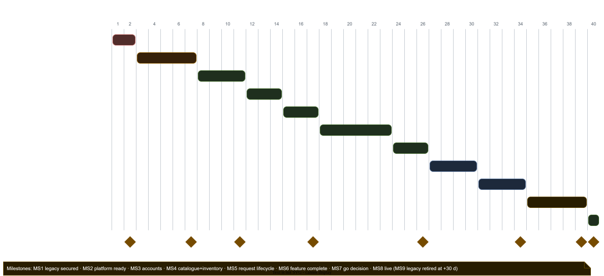

# Implementation Plan: CIMH Stores Platform v2

| | |
|---|---|
| **Document status** | DRAFT |
| **Document owner** | T. Edwards |
| **Related documents** | All planning documents: [PRD](PRD.md) · [TRD](TRD.md) · [TAD](TAD.md) · [BSD](BSD.md) · [API](api/README.md) · [APD](APD.md) · [Design Brief](DESIGN_BRIEF.md) · [Security](SECURITY.md) · [Migration](MIGRATION_PLAN.md) · [Infrastructure](INFRASTRUCTURE.md) · [Test Strategy](TEST_STRATEGY.md) · [Manual](manual/index.html) |
| **Last updated** | 2026-11-07 |

---

## 1. Purpose

Outlines **what gets built and in what order**: the project broken into phases, each with its deliverables, the PRD requirements it covers, dependencies, and the conditions for calling it finished ("exit criteria").

## 2. Assumptions

| # | Assumption |
|---|---|
| 1 | Team: **one developer working with Claude Code** (Python, Vue/TypeScript, Kotlin), plus a part-time product owner (stores) and an admin for approvals and UAT. Estimates are **weeks of elapsed time** for that team; phases run mostly **in sequence** |
| 2 | **No fixed start date or deadline.** Week 1 = whenever work starts; quality gates, not dates, decide when each phase ends |
| 3 | CIMH IT provides the VLAN, IPs and DNS before Phase 1 ends (INFRASTRUCTURE Q1) |
| 4 | The Raspberry Pi 5s, NVMe SSDs and UPS are bought before Phase 1 ends |
| 5 | Every phase follows the Test Strategy gates; "done" = merged to `main`, deployed to staging, tests green, the manual and CLAUDE.md updated |
| 6 | The legacy app keeps running (with Phase 0 fixes) until the cut-over in Phase 10 |

## 3. Phases at a glance

| Phase | Name | Weeks | Depends on | Main PRD scope |
|---|---|---|---|---|
| **P0** | Legacy security fixes and hygiene | 1–2 | — | SECURITY §6 |
| **P1** | Foundations (repo, CI, infrastructure, platform, shared libraries) | 3–7 | P0 (secrets rotated) | P1–P6, TR-CI, TR-SEC |
| **P2** | Identity and access | 8–11 | P1 | A1–A13 |
| **P3** | Catalogue and media | 12–14 | P2 (auth) | C1–C8 |
| **P4** | Inventory and warehouse | 15–17 | P3 (products) | I1–I11 |
| **P5** | Orders, quotes and agreements | 18–23 | P3, P4 | O1–O15 |
| **P6** | Documents and notifications | 24–26 | P5 (events) | D1–D4, N1–N3 |
| **P7** | Web frontends complete (SHOP + SIA) and design polish | 27–30 | P2–P6 APIs | APD screens, Design Brief |
| **P8** | SIA Mobile on the v2 API | 31–34 | P2, P4, P5 | M1–M9 |
| **P9** | Hardening: performance, resilience, pen test, migration rehearsals, UAT | 35–39 | P7, P8 | TR-PERF, TR-AVAIL, Test Strategy §11 |
| **P10** | Cut-over, hypercare, legacy retirement | 40 (+30 days) | P9 go decision | MIGRATION_PLAN §8–10 |

**Estimated total: about 40 weeks to go-live (realistic range 34–46), then 30 days of hypercare.** With one developer the phases run in sequence; Claude Code carries much of the implementation, test writing and documentation, which is what makes this feasible. Each phase still ends on its **exit criteria**, not on a date.

## 4. Phases in detail

### P0: Legacy security fixes and hygiene (weeks 1–2)
| Deliverables |
|---|
| Commit and deploy the existing Phase-0 fixes (eval removal, pooled Mongo client, regex escaping, token checks, logout revocation, health endpoint, headers) |
| Add `@jwt_required()` + ownership checks to the remaining open legacy routes (product image add/delete, upload, decode, QR batch, barcode, `user/items`), or disable them |
| Set `DEBUG=False` in production; verify TLS termination; nginx hardening deployed |
| **Rotate** every secret in `SIA/.env` and the `cimhAdmin` passwords on both MongoDB servers; create the read-only `svc_migrate_ro` user |
| Put **SHOP under git**; remove build output, customer PDFs, uploads, DBs and logs from repository folders (archive them on the server) |

**Exit:** SECURITY §6 shows no "Open" legacy items except "systemic IDOR (fixed by v2)"; secrets rotated and confirmed.

### P1: Foundations (weeks 3–7)
| Workstream | Deliverables |
|---|---|
| Repository | Monorepo (`services/*`, `web/*`, `packages/*`, `deploy/*`, `docs/*`, `tools/migrate`); CONTRIBUTING.md (doc #13); PR template; branch protection |
| CI | GitHub Actions: lint, types, unit, integration (testcontainers), Schemathesis, SAST/deps/secrets, image build + Trivy + cosign; self-hosted runner on sia-host for deploys |
| Infrastructure | Provisioning checklist INFRASTRUCTURE §10 steps 1–9: host + Pis, VLAN, LUKS, replica set, Kafka (SASL/ACL), Redis (ACL), ClamAV, Prometheus/Alertmanager, nginx + certs, backups + first restore test |
| Shared code | `packages/py-common` (auth/JWKS, role and ownership decorators, error format, outbox relay, idempotent consumer, logging, metrics); `packages/event-schemas` (from AsyncAPI); `packages/web-api` (generated clients); `packages/web-ui` (Vuetify 4 theme from the Design Brief, base components) |
| Test tooling | Authz matrix generator (Test Strategy §5), transition-table test generator, seed data scripts |
| Service skeleton | One "hello" service deployed through the whole pipeline to staging and production (health, metrics, logs, alerts) |

**Exit:** a skeleton service goes PR → staging → production with all gates; replica set healthy (1 primary + 2 secondaries); backup restore tested; alerts arrive by email.

### P2: Identity and access (weeks 8–11)
| Deliverables | PRD |
|---|---|
| identity-svc: register, verify, login/refresh/logout (rotation + reuse detection), password reset, MFA (admins, Must), JWKS, service tokens, lockout, breached-password check | A1, A2, A6, A8, A9 |
| Account status flow incl. `@cimh.edu.bb` auto-activate; admin approvals (single + bulk), organisations (CRUD, merge), roles, suspend/reactivate; auditlog consumer | A3, A3a, A4, A5, A7, A10, A11, A13 |
| Profile and addresses | A12 |
| Screens: S-13…S-19, A-16, A-17, A-18, A-20, A-21; login in Mobile skeleton | APD |
| Emails (temporary direct SMTP until P6): verification, approval decision | A5 |

**Exit:** J-01 and J-11 pass end-to-end; authz suite green for identity endpoints; token tests (T-01…T-11) pass.

### P3: Catalogue and media (weeks 12–14)
| Deliverables | PRD |
|---|---|
| catalog-svc: products (public/staff views, `xuser` view), text search, Pro Bono flag and limits, reference data, settings (fees, email lists, workflow) | C1–C5, C8 |
| media-worker (GPU, rembg, WebP, EXIF strip), image upload flow | C6 |
| Screens: S-01 (with the OpenArt.ai hero image), S-02, S-03, S-04, S-06; A-05, A-06, A-07, A-19 | C7, APD |

**Exit:** J-10 passes; catalogue p95 < 300 ms on seeded data; customers never receive staff fields (snapshot tests).

### P4: Inventory and warehouse (weeks 15–17)
| Deliverables | PRD |
|---|---|
| inventory-svc: sites/locations/shelves (via catalog `misc`), units, labels, stow/pick/relocate/assign with idempotency, stock levels, low-stock events, history | I1–I8, I10 |
| Reservations (transactions) + availability endpoint | I9, I11 |
| Screens: A-08 … A-15, global scan box | APD |

**Exit:** concurrency test (two reservations for the last units) passes; stock counts reconcile with history; J-09 web parts pass.

### P5: Orders, quotes and agreements (weeks 18–23)
| Deliverables | PRD |
|---|---|
| order-svc: cart (one per user, Pro Bono limits, CIMH restriction), submission with split, staff queue, status machines (paid and Pro Bono) | O1–O4, O12–O14 |
| Quoting: start-quoting with stock check, quote builder (supplier + CIMH option, exchange rate), send/revise, expiry job + reminders | O5, O5a, O7, O15 |
| Agreement: choose options → agreement PDF request → signed upload → accept; staff verify/reject signature; purchase orders | O6, O6a, O8 |
| Picking (CIMH/Pro Bono lines only), shipping (manual carrier + tracking), delivery | O9–O11 |
| Screens: S-07 … S-12, A-01, A-02, A-03, A-04 | APD |

**Exit:** J-02 … J-07 pass end-to-end; every illegal transition returns 409 (generated tests); acceptance records the signed file and IP.

### P6: Documents and notifications (weeks 24–26)
| Deliverables | PRD |
|---|---|
| document-svc: uploads (magic bytes, ClamAV, size), permission-checked downloads (X-Accel), generated PDFs: CIMH quote, **agreement**, invoice, commercial invoice, Pro Bono invoice, labels | D1–D4 |
| notification-svc: all emails (APD §7 deep links, Design Brief §13 template), retries + DLQ; replace P2's temporary SMTP | N1–N3 |

**Exit:** every email in the APD §7 table is sent exactly once per event with the right link; EICAR file is quarantined; download permission matrix passes.

### P7: Web frontends complete and design polish (weeks 27–30)
| Deliverables |
|---|
| All APD screens finished for SHOP and SIA with the Design Brief components (status timeline, quote comparison, agreement stepper, dashboard counters, approval cards) |
| Light/dark themes, responsive down to 360 px, keyboard shortcuts (SIA), empty/loading/error states (APD §2) |
| Accessibility pass: axe clean, NVDA run |

**Exit:** all 11 journeys pass in 3 browsers + mobile viewport; 0 serious/critical axe issues.

### P8: SIA Mobile on the v2 API (weeks 31–34)
| Deliverables | PRD |
|---|---|
| Move the Android app to the v2 API (generated client), new token flow in Keystore, app lock, certificate pinning | M1, M9, TR-SEC-11 |
| Scanning flows: lookup, stow, pick, pick order, ship; offline queue with idempotency keys; sync screen | M2–M8 |
| Material 3 theme from the Design Brief; tested on the Galaxy Note 10+ and an Android 11 emulator | — |

**Exit:** J-09 passes on the physical device including offline sync; internal release build signed and distributable.

### P9: Hardening (weeks 35–39)
| Deliverables |
|---|
| k6 performance runs (Test Strategy §6) → **decide the 64 GB upgrade** (INFRASTRUCTURE Q4) |
| Resilience tests (Test Strategy §7) incl. power-cut + manual Pi unlock |
| **Penetration test by Claude** on staging (written scope), fixes of all high+ findings |
| Migration: tooling `tools/migrate` M01–M09, dry runs **DR-1, DR-2, DR-3**; admin organisation review; customer-organisation assignment complete |
| UAT by staff and admins (staff play customers with test accounts); product-owner sign-off |
| Operations docs ready (#21–#25): deployment, operations, DR, monitoring, incident response |

**Exit = go-live criteria** (Test Strategy §11): 0 open S1/S2; RTM 100 % of Musts; performance/resilience met; pen-test high+ fixed; DR-3 ≤ 45 min; UAT signed.

### P10: Cut-over and hypercare (week 40 + 30 days)
| Deliverables |
|---|
| Announce (T-5 d), cut-over runbook (MIGRATION_PLAN §8), go/no-go, smoke tests |
| Hypercare: daily alert review and a feedback link in SHOP for the first month; rollback allowed ≤ 48 h |
| Day 30: archive the legacy database and files (restic), decommission Flask, delete the SQLite token store |
| Project close-out report (#32) |

## 5. Milestones

| # | Milestone | Week | Evidence |
|---|---|---|---|
| MS1 | Legacy secured | 2 | SECURITY §6 updated, secrets rotated |
| MS2 | Platform ready | 7 | Skeleton service in production; RS + Kafka + backups verified |
| MS3 | Accounts live on staging | 11 | J-01, J-11 green |
| MS4 | Catalogue + inventory on staging | 17 | J-09 (web), J-10 green |
| MS5 | Request lifecycle complete | 26 | J-02…J-07 green, emails and PDFs |
| MS6 | Feature complete (web + mobile) | 34 | All journeys green, a11y clean |
| MS7 | Go decision | 39 | Go-live criteria met |
| MS8 | Live on v2 | 40 | Cut-over done |
| MS9 | Legacy retired | 40 + 30 d | Archive confirmed, Flask off |

## 6. Remaining documentation schedule

| Doc (# in index) | When | Phase |
|---|---|---|
| Coding Standards and Contribution Guide (#13) | Weeks 3–4 | P1 |
| Service / App READMEs (#14) | With each service | P1–P8 |
| ADR files `docs/adr/` (TAD §11) | Weeks 3–5, then as decided | P1+ |
| Test plans and cases (#16), RTM (#17) | From P2, generated from tags | P2+ |
| Changelog and release notes (#18) | Every release | P1+ |
| Migration dry-run reports (#19) | DR-1/2/3 | P9 |
| Load and security test reports (#20) | P9 | P9 |
| Deployment, Operations, DR, Monitoring, Incident runbooks (#21–#25) | Weeks 35–39 | P9 |
| User guides, Admin guide, Training (#26–#28) | Weeks 30–39 | P7–P9 |
| Support policy, Privacy policy and Terms (#29, #30) | Before go-live | P9 |
| Handover guide (#31), Close-out (#32) | Hypercare end | P10 |

The manual (`docs/manual/`) is updated with every document change (CLAUDE.md rule).

## 7. Roles

| Role | Responsibilities |
|---|---|
| Product owner (stores) | Priorities, acceptance of each phase, UAT sign-off, customer communication |
| Tech lead | Architecture decisions/ADRs, reviews, release gates, cut-over lead |
| Developer (1) + Claude Code | Services, frontends, mobile, tests, docs, migration tooling; the developer reviews and approves everything Claude Code produces |
| Claude | Also runs the penetration test (staging, written scope) and keeps CLAUDE.md and the manual current |
| Admin(s) | Organisation review, approval workflow testing, settings |
| Stores staff | SIA/Mobile UAT, warehouse device testing |
| CIMH IT | VLAN, IPs, DNS, firewall, mail server settings, UPS |

## 8. Schedule risks

| # | Risk | Impact | Mitigation |
|---|---|---|---|
| IR1 | CIMH IT network setup late | P1 slips, blocks everything | Request in week 1; develop on local/staging Compose meanwhile |
| IR2 | Hardware (Pis, SSDs, UPS, RAM) late | P1 / P9 slip | Order in week 1; staging can run single-node |
| IR3 | **Single developer**: availability (leave, illness) stops the project, and knowledge sits with one person (bus factor 1) | Every phase stretches; handover risk | Keep the docs, the manual and CLAUDE.md current (already a rule) so another developer, with Claude Code, can pick up from them; small, reviewed PRs; ADRs for every decision |
| IR4 | 32 GB memory insufficient under load | P9 fails performance | Decide 64 GB upgrade at P9 start using k6 results |
| IR5 | Kafka/outbox complexity slows P5 | Core flow late | Shared `py-common` outbox and consumer built and tested in P1 |
| IR6 | Mobile migration harder than expected | P8 slips | Legacy mobile app keeps working until cut-over; P8 can start earlier if P7 waits on feedback |
| IR7 | Free-text legacy data mapping issues | Migration delay | DR-1 early in P9 (or as soon as `tools/migrate` exists) |

## 9. Scope control

- **No deadline, so the first release = all PRD "Must" and "Should" requirements.** The schedule is driven by exit criteria, not dates.
- "Could" items (C7 landing samples, M8 offline polish, typo-tolerant search, distributed tracing, DHL API) are deferred to release 1.1+.
- Any new requirement goes through the PRD (new id), then this plan.

## 10. Questions

| # | Question | Outcome |
|---|---|---|
| 1 | Start date and team size? | **Resolved:** no set start date; **one developer with Claude Code** (estimates above). |
| 2 | Fixed go-live deadline? | **Resolved:** no. Scope = Musts + Shoulds; phases end on exit criteria. |
