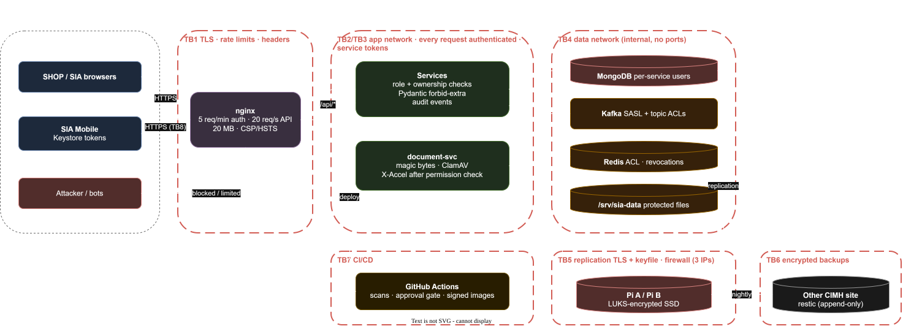

# Security and Threat Model: CIMH Stores Platform v2

| | |
|---|---|
| **Document status** | DRAFT |
| **Document owner** | T. Edwards |
| **Related documents** | [TAD §8](TAD.md) · [TRD §4.2, §5](TRD.md) · [BSD §3](BSD.md) · [API §2–3](api/README.md) · [APD](APD.md) · [Manual](manual/index.html) |
| **Method** | STRIDE per component and trust boundary; risk = likelihood × impact (L/M/H) |
| **Last updated** | 2026-11-06 |

---

## 1. Purpose and scope

A systematic analysis of **what needs protecting, the threats against it, and the controls that reduce each threat**. It is the checklist for the pre-launch security review (PRD goal: zero critical findings) and for every code review touching auth, data access, files or infrastructure.

- **In scope:** SHOP, SIA, SIA Mobile, nginx, the 6 services and media-worker, Kafka, Redis, MongoDB replica set (host + 2 Pis), the file volume, backups, CI/CD, and the legacy Flask app during the transition.
- **Out of scope:** the CIMH mail server and corporate network (dependencies; their owners secure them), OpenArt.ai (used offline for one image only).

## 2. Assets

| # | Asset | Where | Sensitivity | Why it matters |
|---|---|---|---|---|
| A1 | Account credentials and sessions (password hashes, refresh tokens, MFA secrets) | `accounts`, Redis | **Critical** | Account takeover, admin takeover |
| A2 | Personal data (names, emails, phones, addresses, organisation, IPs) | `accounts`, `orders` (`customerSnapshot`, `shipTo`, `billTo`), `auditlog` | **High** | Privacy law (Barbados Data Protection Act 2019), trust |
| A3 | Signed payment agreements and quotes | File volume, `orders.agreement` | **High** | Legal commitment to pay; financial dispute evidence |
| A4 | Pricing and supplier data (cost, supplier names, purchase orders, exchange rates) | `product.cost`, `orders.quotes`, `purchaseOrders` | **High** | Commercial confidentiality |
| A5 | Stock integrity (units, reservations, history) | `storage`, `history`, `stock` | **High** | Theft concealment, overselling |
| A6 | Request status integrity (who accepted what, when) | `orders.history`, `auditlog` | **High** | Non-repudiation of acceptance |
| A7 | Service secrets (DB users, JWT signing key, SMTP, service credentials, backup keys) | `.env` / Docker secrets | **Critical** | Full compromise |
| A8 | Availability of SHOP/SIA/Mobile | Main host | Medium | Operations stop |
| A9 | Backups | Pi B → other CIMH site | **Critical** | Recovery and also a full copy of A1–A6 |

## 3. Threat actors

| Actor | Motivation | Capability |
|---|---|---|
| Opportunistic internet attacker / bot | Credential stuffing, scraping, spam, crypto-mining | Automated tools, leaked password lists |
| Malicious registrant | Get access to pricing, impersonate an organisation | Can register; must pass admin approval |
| Approved customer acting outside their rights | See other organisations' requests or quotes; tamper with acceptance | Valid `user` token |
| Insider (staff) | Hide theft (stock manipulation), leak supplier pricing | Valid `staff` token, physical access to the warehouse |
| Compromised staff/admin device or account | Anything that account can do | Stolen session or phished password |
| Network attacker on the CIMH LAN | Intercept or attack the Pis and MongoDB | LAN access |
| Supply-chain attacker | Malicious dependency, image or skill | Code execution in build or runtime |

## 4. Trust boundaries and data flows

| Boundary | Crossing | Protection |
|---|---|---|
| **TB1** Internet → nginx | All client traffic | TLS 1.2+, HSTS, rate limits, request size limits, security headers |
| **TB2** nginx → services | `/api/*` proxied | Internal network `app`; services still authenticate every request (no trust in nginx headers other than `X-Forwarded-*` from the known proxy) |
| **TB3** Service → service | Internal HTTP | Service tokens (5 min), `/internal/*` never routed by nginx |
| **TB4** Services → data (MongoDB, Kafka, Redis) | Queries, events | `data` network is internal; per-service MongoDB users with least privilege; Kafka/Redis passwords; no host ports published |
| **TB5** Main host ↔ Pis | Replication | TLS + keyfile/x.509; firewall allows only the 3 fixed IPs |
| **TB6** Host / Pi B → other CIMH site | Backups | restic (encrypted client-side), append-only credentials |
| **TB7** Developer / CI → production | Deploys | GitHub Actions, protected branch, environment approval, SSH deploy key limited to `docker compose` |
| **TB8** Mobile device ↔ API | Offline queue | Keystore-encrypted tokens; queued scans hold no personal data |

## 5. Threats and controls (STRIDE)

Status: ✅ designed (in TAD/TRD/API) · 🛠 build task · ⚠ residual risk accepted / needs decision.

### 5.1 Identity and access (identity-svc, login)

| ID | STRIDE | Threat | Risk | Controls | Status |
|---|---|---|---|---|---|
| T-01 | S | Credential stuffing / brute force on `/auth/login` | H | nginx 5 req/min/IP on auth; per-account lockout after 5 failures (15 min, increasing); Argon2id; breached-password check at sign-up/reset; generic error messages | ✅ |
| T-02 | S | Account enumeration via register / forgot / login responses | M | Register and forgot always return 202; login uses the same error for unknown email and bad password; timing-equalised hashing | ✅ |
| T-03 | S | Stolen refresh token reused | H | Rotation on every refresh; **reuse detection revokes the whole session family**; HttpOnly cookies (web), Keystore (mobile) | ✅ |
| T-04 | S | Admin account takeover | H | **TOTP MFA required for admin** (TRD TR-AUTH-9, Must); admin sessions 8 h max; audit of every admin action; alert on admin login from a new IP | ✅ |
| T-05 | S/E | Malicious registrant claims a member organisation | M | **Admin approval** with organisation link; domain match hint; `@cimh.edu.bb` auto-approve only after email verification and **no request rights** | ✅ |
| T-06 | E | JWT forgery / algorithm confusion | H | EdDSA only; library pinned to `alg=EdDSA`; key from JWKS by `kid`; `exp`, `nbf`, `iss`, `aud` checked | ✅ |
| T-07 | S | Verification / reset code guessing | M | 6 digits, hashed, 15 min, 5 attempts, 3 resends/hour, rate-limited endpoint | ✅ |
| T-08 | R | User denies having accepted a quote | M | Acceptance records user, time, IP, choices **and the signed agreement file** (SHA-256); `auditlog` (insert-only) | ✅ |
| T-09 | E | Suspended user keeps working with a live token | M | Suspension writes revoke-all marker in Redis, checked on every request | ✅ |
| T-10 | I | Session theft via XSS | H | No `v-html` with user data (lint rule); strict CSP (`script-src 'self'`, no inline); HttpOnly cookies; DOMPurify for any rich text | ✅ (pen test 2026-11: no `v-html`/`innerHTML`; CSP at the production edge) |
| T-11 | T | CSRF on cookie-authenticated changes | H | `SameSite=Lax` + double-submit `X-CSRF-Token` on POST/PUT/PATCH/DELETE | ✅ |

### 5.2 Authorisation and data access (all services)

| ID | STRIDE | Threat | Risk | Controls | Status |
|---|---|---|---|---|---|
| T-12 | I/E | **IDOR**: reading another user's/organisation's request, files, profile by changing an id (present in legacy) | **H** | Caller identity passed into every repository call; queries always filtered by `customer` / `organisationId` for `user`; hidden = 404; **automated IDOR tests per endpoint** in CI | ✅ (generated matrix in CI; pen test 2026-11) |
| T-13 | E | Customer calls staff endpoints | H | Role declared per route (decorator), deny by default; contract tests assert 403 for each role | ✅ |
| T-14 | I | Over-exposure of fields (cost, supplier, serials) to customers | H | Separate response models (`ProductPublic` vs `ProductStaff`); `xuser` view projects public fields only; snapshot tests on customer responses | ✅ |
| T-15 | E | Mass assignment (setting `role`, `status`, `version`, `cost` via PATCH) | H | Pydantic `extra="forbid"`; separate input models without privileged fields | ✅ |
| T-16 | T | Same-organisation colleague accepts or cancels someone else's request | M | Only requester or admin may act; org members are read-only | ✅ |
| T-17 | T/R | Insider manipulates stock to hide theft | M | Every stow/pick/relocate in `history` with user + time; picks need a reason or a reserved request; low-stock + reconciliation report; no delete endpoints for units | ✅ · ⚠ periodic stock-take process (organisational) |
| T-18 | T | Staff alters a sent quote or acceptance after the fact | M | Quotes are versioned and append-only; acceptance immutable; status changes conditional + audited | ✅ |

### 5.3 Input handling (all services)

| ID | STRIDE | Threat | Risk | Controls | Status |
|---|---|---|---|---|---|
| T-19 | E | **Code injection via `eval`** (present in legacy Flask: 13 places) | **Critical** | No dynamic evaluation anywhere; Bandit/Semgrep rule bans `eval`/`exec`/`pickle` on input | ✅ legacy fixed (Phase 0) · ✅ v2 rule |
| T-20 | T/D | **NoSQL/regex injection, ReDoS** (legacy unescaped `$regex`, user-controlled field names) | H | Text index search; any regex built from escaped input and anchored; field names from allow-lists only; operators (`$`-keys) rejected in input | ✅ |
| T-21 | T | Template injection in emails (legacy f-string HTML) | M | Jinja2 with autoescape; never build HTML by string concatenation | ✅ |
| T-22 | D | Oversized payloads, deep JSON, huge pages | M | nginx `client_max_body_size 20M`; JSON size/depth limits; `limit` ≤ 100 | ✅ |

### 5.4 Files (document-svc, media-worker, nginx)

| ID | STRIDE | Threat | Risk | Controls | Status |
|---|---|---|---|---|---|
| T-23 | E/T | Malicious upload (polyglot PDF, script, path traversal filename) | H | Type checked by magic bytes; allow-list PDF/JPEG/PNG/WebP; random UUID names; never use user filename in paths; images re-encoded; PDFs stored as data only, never rendered server-side except by our own generator | ✅ |
| T-24 | I | Downloading another customer's signed agreement/quote | H | Permission check per download (owner/org or staff) before `X-Accel-Redirect`; `/_protected/` is `internal` in nginx | ✅ |
| T-25 | T | Forged signed agreement (customer uploads an unsigned or edited PDF) | M | Staff verification required before purchasing; agreement PDF carries request id, quote version, total and a hash of the generated file printed in the footer; SHA-256 of the upload stored | ✅ · ⚠ no cryptographic e-signature (manual signature accepted by business decision) |
| T-26 | D | Image-processing bombs (decompression bombs, huge dimensions) | M | Pillow `MAX_IMAGE_PIXELS`; size limit; media-worker isolated with memory limit and timeout | ✅ |
| T-27 | E | Malware in uploads reaching staff machines | M | ClamAV scan in document-svc before files become downloadable (quarantine on hit, fail closed if clamd is down); type from magic bytes; images re-encoded. Built in P6, EICAR test passes. **Staging-lite does not scan** (no memory; owner decision 2026-11-08) | ✅ (TR-SEC-6) |

### 5.5 Messaging, data stores and infrastructure

| ID | STRIDE | Threat | Risk | Controls | Status |
|---|---|---|---|---|---|
| T-28 | S/T | Unauthenticated access to MongoDB/Kafka/Redis | **H** | No published ports on `data` network; MongoDB auth + per-service users; Kafka SASL/SCRAM; Redis ACL user + password; firewall | ✅ (TR-SEC-7) |
| T-29 | T | Forged event injected into Kafka | M | Only service principals can produce, per-topic ACLs (producer = owning service only); consumers validate schema | ✅ (TR-SEC-7) |
| T-30 | I | Sniffing replication traffic on the LAN | M | MongoDB TLS between members; Pis, host on a **dedicated VLAN** | ✅ (TR-SEC-12) |
| T-31 | T/D | Physical theft or tampering of a Raspberry Pi (holds a full DB copy) | M | Pis in a locked rack/room; **encrypted disk (LUKS)** on Pi SSDs; MongoDB encrypted storage not available in Community, so rely on LUKS | ✅ (TR-SEC-10) |
| T-32 | I | Backup theft at the other site | H | restic encryption (key held separately); append-only repo credentials; quarterly restore test | ✅ |
| T-33 | D | DoS / traffic flood | M | nginx rate limits and connection limits; health-checked services; CIMH upstream/ISP protection | ⚠ no WAF/CDN by decision |
| T-34 | E | Container escape / over-privileged containers | M | Non-root users, read-only root FS, `cap_drop: ALL`, `no-new-privileges`, no Docker socket mounts, GPU only for media-worker | ✅ (TR-SEC-8) |
| T-35 | I | Secrets leaked in logs, images, git | **H** | No secrets in git/images (gitleaks in CI); Docker secrets / `0600` env files; log redaction of tokens, passwords, codes | ✅ |

### 5.6 Supply chain and delivery

| ID | STRIDE | Threat | Risk | Controls | Status |
|---|---|---|---|---|---|
| T-36 | T/E | Malicious or vulnerable dependency (PyPI/npm) | H | Lockfiles; pip-audit / npm audit / Trivy in CI (high/critical block); Dependabot; minimal images | ✅ |
| T-37 | T | Malicious Claude Code skill or tooling in the repo | M | Third-party skills reviewed before install (done 2026-11-06); `skills-lock.json` pinned; review diffs on update | ✅ |
| T-38 | E | Compromised CI → production | H | Protected `main`; required reviews; production environment needs manual approval; deploy key can only run the deploy script; images signed (cosign) and verified on pull | ✅ (TR-SEC-9) |

### 5.7 Mobile

| ID | STRIDE | Threat | Risk | Controls | Status |
|---|---|---|---|---|---|
| T-39 | I | Lost/stolen staff phone | M | Tokens in Keystore; app lock with device credential after 5 min inactivity; admin can revoke sessions (suspend / logout-all) | ✅ (TR-SEC-11) |
| T-40 | T | Replayed or tampered offline scans | L | Idempotency key per scan; server re-validates everything; queue holds no tokens | ✅ |
| T-41 | I | Traffic interception on warehouse Wi-Fi | M | HTTPS only (`cleartextTrafficPermitted=false`); certificate pinning (built: ISRG Root X1, X2 and Root YE, pin set expiring 2027-12-31 so a CA change can't lock staff out; pins are roots rather than intermediates because Let's Encrypt rotates intermediates; CIMH CA added if production uses one) | ✅ (TR-SEC-11) |

## 6. Legacy application findings (Flask, running until cut-over)

| Finding | Severity | Status |
|---|---|---|
| `eval()` on request data (13 places) → remote code execution | Critical | **Fixed** (Phase 0, uncommitted) |
| Unauthenticated routes: product image add/delete, upload, decode, QR batch, barcode, `user/items` | High | Partly fixed (`user/<id>`, order files); **remaining routes still open** |
| IDOR: user id taken from URL/body on most routes | High | Partly fixed; **systemic: only fully fixed by v2** |
| Token verification failed open on errors; logout didn't revoke | High | **Fixed** (Phase 0) |
| Regex injection / ReDoS in search | Medium | **Fixed** (escaped) |
| Test email route to a personal address (`/send/<code>`) | Medium | **Removed** |
| `DEBUG=True` in production `.env`; hard-coded fallback `SECRET_KEY` | High | Fallback removed; **set `DEBUG=False` in production** |
| Real credentials in `SIA/.env` on disk; customer PDFs, uploads, DBs, logs inside app folders | High | **Open** |
| TLS 1.0/1.1 enabled, `listen 443` without `ssl` in nginx | Medium | TLS fixed in config; **verify TLS termination** |

**Rule during transition:** the Phase 0 fixes must be committed and deployed now; the remaining open legacy routes get `@jwt_required()` + ownership checks or are disabled before v2 traffic starts.

## 7. Secrets management

| Secret | Holder | Storage | Rotation |
|---|---|---|---|
| JWT signing key (Ed25519) | identity-svc | Docker secret | Yearly; JWKS publishes old + new keys during overlap |
| MongoDB users (`svc_*`, `admin_ops`, `svc_backup`) | Each service / ops | Docker secrets | Yearly + on staff change |
| Kafka SASL, Redis ACL | Services | Docker secrets | Yearly |
| Service credentials (for `/internal/service-token`) | Each service | Docker secrets | Yearly |
| SMTP (CIMH mail) | notification-svc | Docker secret | Per CIMH IT policy |
| restic repository key | Backup job + **offline copy in a safe** | Pi B secret file + paper/USB in safe | Never lost; change on custodian change |
| TOTP secrets | identity-svc (encrypted field) | MongoDB, encrypted with a key from Docker secret | On reset |
| GitHub deploy key, GHCR token | CI | GitHub encrypted secrets / environment | Yearly |

**Immediate actions (before go-live):**
1. **Rotate** every credential in `SIA/.env` and the MongoDB `cimhAdmin` password (shared in chat for **both** 127.0.0.1 and 172.16.0.203).
2. Create a **read-only** MongoDB user for analysis/migration dry runs; stop using `cimhAdmin` for scripts.
3. Remove `.env` from any copy outside the server; confirm it was never committed (`git log -p -- .env`).

## 8. Roles and permissions

Authoritative matrix: [API README §3](api/README.md#3-roles-and-access). Summary: `user` (own + organisation read; act on own), `user@cimh.edu.bb` (browse only), `staff` (operations), `admin` (operations + accounts, organisations, settings, audit). Deny by default; hidden resources return 404.

## 9. Logging, monitoring and audit

| What | Where | Retention |
|---|---|---|
| Security-relevant actions (login success/fail, lockout, MFA, approvals, role changes, suspensions, status changes, file deletes, settings) | `auditlog` (insert-only) | Indefinite |
| Request logs (method, route, status, duration, userId, traceId; **no bodies, tokens or passwords**) | Docker logs | 10 × 50 MB rotation |
| Security alerts (Alertmanager → email) | — | — |

**Security alert rules (TRD TR-OBS-3):** > 20 failed logins/min overall; any account lockout of an admin; admin login from a new IP; token-reuse detections; 403/404 spikes from one user (IDOR probing); ClamAV hit; backup older than 26 h; replica-set member down.

## 10. Privacy (Barbados Data Protection Act 2019)

| Principle | How the platform meets it |
|---|---|
| Lawful purpose and minimisation | Only data needed to supply items: name, email, phone, organisation, addresses; no IDs, no payment data |
| Transparency | Privacy notice at sign-up (Privacy Policy, doc #30); purposes listed |
| Retention | BSD §8: rejected/expired accounts deleted after 90 d; carts 180 d; financial records kept |
| Data subject rights | Access: self-service download (`/me/export`) or by an admin; erasure: the person asks (password), an admin erases; personal data removed, `[deleted]` replacement in requests, audit kept (BSD §8) |
| Security | This document |
| Sharing | Same-organisation visibility (disclosed at sign-up); carriers receive name/address/phone; no third-party analytics or trackers |
| Breach notification | Incident Response Plan (doc #25): assess within 24 h, notify the Data Protection Commissioner and affected people without undue delay where required |
| Location | All data on CIMH premises (host, Pis, other CIMH site); no cloud processors |

## 11. Vulnerability management and testing

| Activity | When | Tool / owner |
|---|---|---|
| Dependency, image, secret scanning | Every PR + nightly | pip-audit, npm audit, Trivy, gitleaks |
| SAST | Every PR | Semgrep (OWASP + custom rules: no `eval`, no `v-html`, no raw `$regex`), Bandit |
| Authorisation tests (IDOR, role matrix) | Every PR | pytest contract tests generated from the API role table |
| DAST | Before each release (staging) | OWASP ZAP baseline + authenticated scan |
| Penetration test | Before go-live, then yearly | **Performed by Claude (Claude Code)** against **staging**, under a written scope/authorisation from the owner (no production, no DoS): OWASP ASVS L2, authenticated ZAP full scan, manual exploitation attempts for every T-xx threat; tech lead reviews findings; scope = SHOP, SIA, API, Mobile |
| Patch windows | Monthly (OS, Docker, images); critical within 72 h | Ops |
| Security review gate | Pre-launch | Checklist = every T-xx row ✅ or accepted ⚠ with sign-off |

**Pen test 2026-11 (local dev stack, owner-approved scope):** [security/PENTEST-2026-11.md](security/PENTEST-2026-11.md), findings in [security/PENTEST-2026-11-findings.md](security/PENTEST-2026-11-findings.md). 8 findings; all fixed (F-01, the production edge, built in P9; live check at the first deploy) except F-05 (accepted). Repeatable probes: `tools/security/probes.py`. A rerun against staging-sized infrastructure and a fresh-context review (R7) remain.

## 12. Residual risks and decisions

| # | Risk | Recommendation | Outcome |
|---|---|---|---|
| R1 | No WAF/CDN (decision: nginx only) → limited DDoS protection | Accept; rely on rate limits + ISP; revisit if attacked | **Accepted** |
| R2 | Signed agreements are hand/scan signatures, not cryptographic e-signatures | Accept (business decision); staff verification + hashes | **Accepted** |
| R3 | Main host single point of failure (also a security availability risk) | Accept (documented in TAD R1) | **Accepted** |
| R4 | Pis on the general LAN | Put the 3 database machines on a dedicated VLAN | **Agreed**: TR-SEC-12 |
| R5 | MFA for admins is "Should" in TRD | **Make it Must** | **Agreed**: TR-AUTH-9 is Must |
| R6 | ClamAV, Kafka SASL/ACLs, Redis ACL, container hardening, cosign, LUKS on Pis, mobile cert pinning and app lock are not yet in the TRD | Add them to TRD as requirements | **Agreed**: TR-SEC-6 to TR-SEC-11 |
| R7 | No **independent** penetration test (no budget): the test is run by Claude within the project, so it may share the design's blind spots | Claude-run pen test (ASVS L2 + authenticated DAST + manual probes) with a fresh-context review; reconsider an external test if budget appears or after any incident | **Accepted** |
