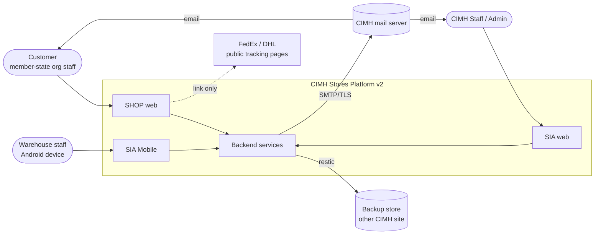
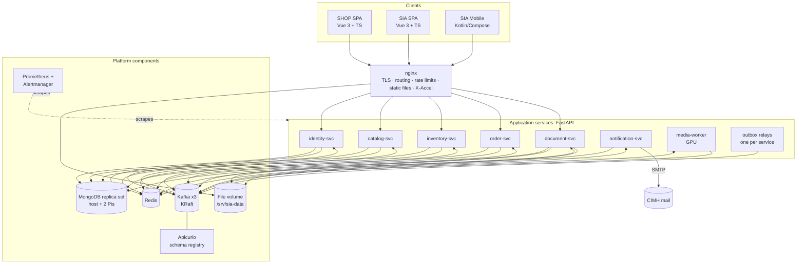
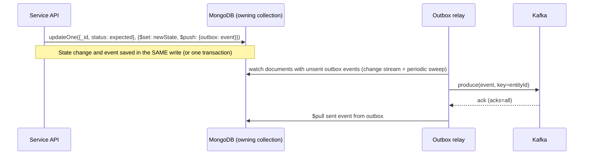
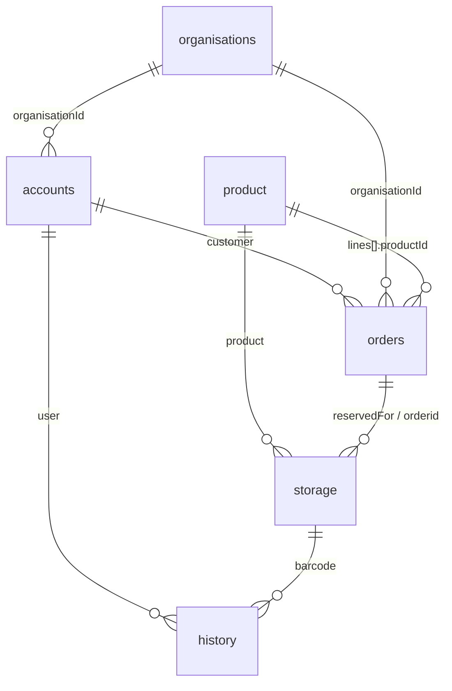
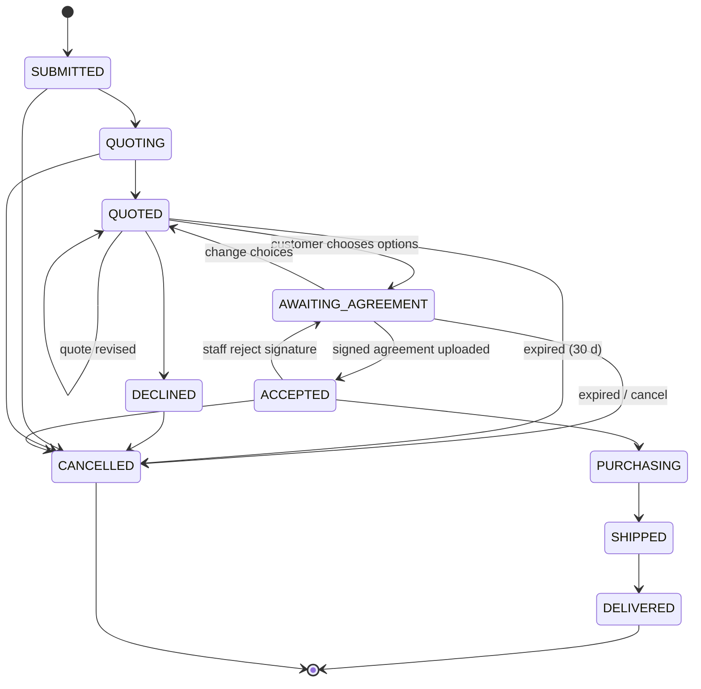
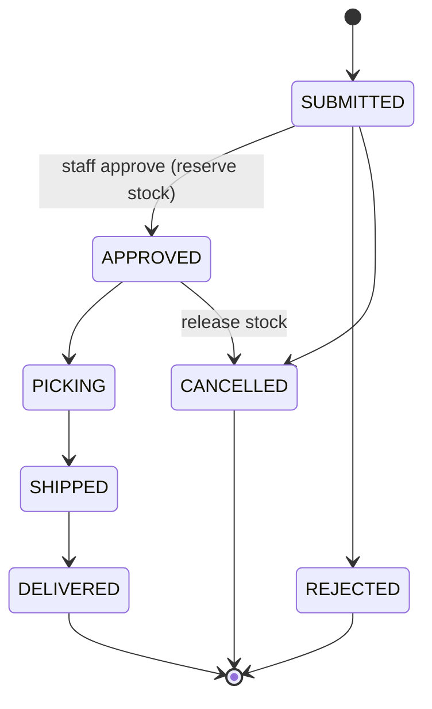
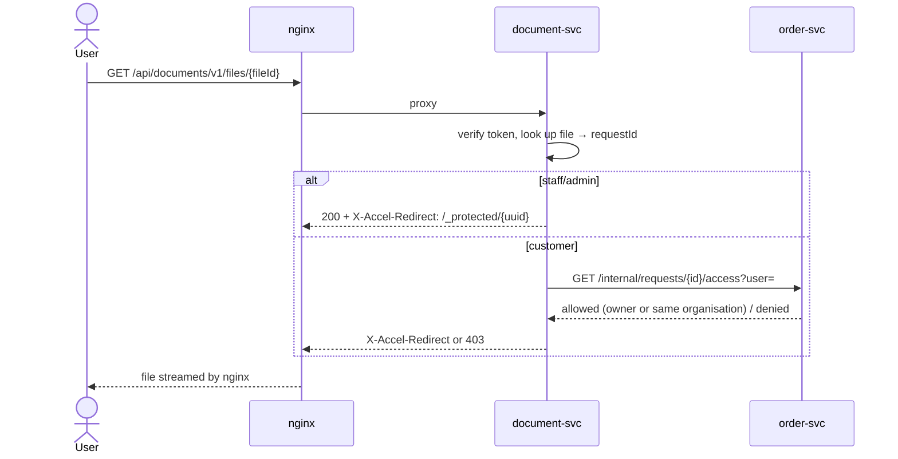
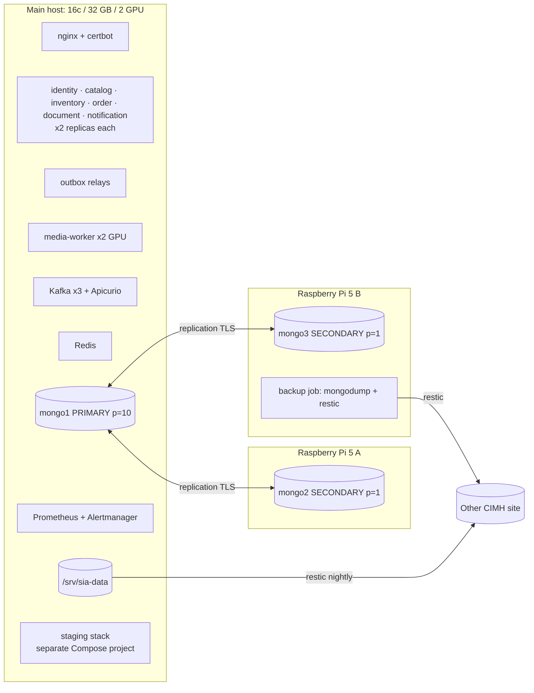

# Technical Architecture Document (TAD): CIMH Stores Platform v2

| | |
|---|---|
| **Document status** | DRAFT |
| **Document owner** | T. Edwards |
| **Related documents** | [PRD](PRD.md) · [TRD](TRD.md) · BSD (planned) · API Spec (planned) · [Documentation Index](DOCUMENTATION_INDEX.md) |
| **Last updated** | 2026-11-06 |

---

## 1. Introduction

### 1.1 Purpose
This document explains **how the CIMH Stores Platform v2 is built**: what the parts are, how they connect, and why it was designed that way. It turns the [PRD](PRD.md) requirements and the [TRD](TRD.md) technology choices into a concrete design.

### 1.2 Scope
- **In scope:** SHOP (customer web store), SIA (staff web app), SIA Mobile (Android), the backend microservices, messaging, data storage, files, the edge layer, deployment and operations.
- **Out of scope:** field-level schemas (in the BSD), endpoint contracts (in the API Specification), visual design (in the Design Brief).

### 1.3 Architectural drivers
| Driver | Source | Effect on the architecture |
|---|---|---|
| Up to 1M registered users, about 1,000 requests/s at peak | PRD §2, TRD §2 | Services that hold no state and can be scaled out; pooled connections; indexed queries; cursor paging |
| Security flaws in the current system | PRD §3 | Login handled centrally in one service, while every service checks tokens itself; roles and ownership checked everywhere; validated input |
| Request → quote → accept workflow with CIMH stock option | PRD O3–O8, O5a | order-svc runs the request status flow; inventory-svc reserves stock inside transactions |
| Admin approval of accounts | PRD A3 | identity-svc runs the account status flow |
| MongoDB required; existing collection names kept | PRD §4 | One `inventory` database; each collection owned by exactly one service |
| Kafka for communication between services | Decision | Events for everything that "has happened"; HTTP only for queries that need an answer immediately |
| Docker Compose only; local files; nginx edge | TRD §10 | Two physical tiers (main host + Pis); one shared file volume; nginx serves files via `X-Accel-Redirect` |
| Hardware: 1 host (16 cores, 32 GB, 2 GPUs) + 2 Raspberry Pi 5 | TRD §6 | Everything except the MongoDB secondaries runs on the main host; GPUs used for image work |

### 1.4 Architectural principles
1. **Each service owns its data.** Only the owning service reads or writes a collection. Everything else goes through that service's API or events.
2. **Events for facts, HTTP for questions.** Changes of state are published to Kafka. Synchronous HTTP is used only when the caller needs an answer right away.
3. **Services hold no state.** Sessions, rate limits and locks live in Redis; files live on the shared volume. Any replica can serve any request.
4. **Never trust the client.** Every request is authenticated, authorised by role and checked for ownership on the server.
5. **Events can't be lost and can be applied twice safely.** The outbox stores the event in the same write as the change; consumers detect duplicates.
6. **Keep it simple.** No technology that Docker Compose on one host plus two Pis can't run.

---

## 2. System context



| External actor or system | Interaction |
|---|---|
| Customer (`user`) | Registers, browses, submits requests, reviews and accepts quotes, tracks requests, all through SHOP |
| Staff (`staff`) | Manages products, stock, request desk, quotes, purchasing and shipping through SIA and SIA Mobile |
| Admin (`admin`) | Everything staff can do, plus account approvals, organisations, roles, settings and the audit log |
| CIMH mail server | All outgoing email (SMTP over TLS) |
| Backup store (other CIMH site) | Encrypted nightly backups (restic) |
| FedEx / DHL | **No integration.** SHOP links to their public tracking pages using the tracking number staff entered |

---

## 3. Container view



| Container | Technology | Responsibility |
|---|---|---|
| SHOP SPA | Vue 3, TypeScript, Vuetify 4, Pinia, file-based routing, Zod 4 | Customer store |
| SIA SPA | Same stack | Staff and admin app |
| SIA Mobile | Kotlin, Jetpack Compose, Room, WorkManager, CameraX/ML Kit | Scanning on the warehouse floor; offline queue |
| nginx | nginx | TLS, serving both SPAs, routing `/api/*` to services, rate limiting, public images, protected downloads (`X-Accel-Redirect`) |
| identity-svc | FastAPI | Accounts, organisations, login, tokens, approvals, roles, audit log |
| catalog-svc | FastAPI | Products, search, Pro Bono items and limits, reference data (`misc`), product images metadata |
| inventory-svc | FastAPI | Sites, locations, shelves, storage units, stow, pick, relocate, stock levels, reservations, movement history |
| order-svc | FastAPI | Carts, order requests, status flows, quotes (supplier + CIMH), acceptance, purchasing, shipping |
| document-svc | FastAPI | PDF generation (quotes, invoices, commercial invoices), uploads, protected downloads |
| notification-svc | FastAPI (consumers only) + Jinja2 | All email, driven by events |
| media-worker | Python, rembg, onnxruntime-gpu | Background removal, resizing, WebP versions, barcode decoding |
| outbox relay | Python (one small process per service) | Publishes saved events from each service's documents to Kafka |
| Kafka | Apache Kafka (KRaft) ×3 | Event backbone |
| Apicurio | Apicurio Registry | Event schemas and compatibility checks |
| Redis | Redis | Token revocation, rate limits, idempotency keys, processed-event IDs, leader locks, cache |
| MongoDB | Replica set (primary on host, 2 secondaries on Pis) | All business data (`inventory` database) |
| File volume | Docker volume | PDFs, uploads, product images, QR codes |
| Prometheus + Alertmanager | Prometheus | Metrics, alert rules, email alerts |

---

## 4. Service catalogue

Each service has the same internal structure:

```
api/          FastAPI routers (HTTP)
domain/       entities, status flows, business rules (no I/O)
repository/   MongoDB access (Beanie/PyMongo Async), the only code that touches collections
events/       producers (outbox), consumers (Kafka), event schemas
jobs/         scheduled jobs (APScheduler, run by the leader replica only)
auth/         shared token-checking library (from packages/)
```

### 4.1 identity-svc
| Aspect | Detail |
|---|---|
| **Responsibilities** | Registration, email verification, admin approval, login/logout, token issue/refresh/revoke, password reset, profile, roles, suspension, organisations, audit log |
| **Owns** | `accounts`, `temp`, `organisations`, `auditlog` |
| **Public API** | `/api/identity/v1/*`: auth, accounts, admin/approvals, organisations, audit |
| **Publishes events** | `identity.user.events`: `user.registered`, `user.verified`, `user.approved`, `user.rejected`, `user.suspended`, `user.reactivated`, `user.role_changed`, `user.profile_updated`, `user.approval_pending`, `user.erasure_requested`, `user.deleted` (purge or admin erasure) |
| **Consumes** | `audit.events` (from all services) → writes to `auditlog` |
| **Scheduled jobs** | Expire unverified accounts (24 h); remind admins of approvals pending > 48 h (`user.approval_pending`, once per account); delete `REJECTED`/`EXPIRED` accounts after 90 days in two phases (strip personal data and queue `user.deleted` on the document, then remove it once published). Process `identity-jobs` (`python -m identity_svc.jobs`), one leader via a Redis lock; consumer process `identity-audit-consumer` |
| **Special** | Holds the **private signing key**. Publishes its public keys at `/.well-known/jwks.json` so other services can verify tokens. `@cimh.edu.bb` accounts skip approval |

### 4.2 catalog-svc
| Aspect | Detail |
|---|---|
| **Responsibilities** | Products (create, edit, search, browse), sellable/PROBONO flags, Pro Bono per-item limits, departments/types/projects/fees/email lists (`misc`), product image records |
| **Owns** | `product`, `xuser` (view), `misc` |
| **Public API** | `/api/catalog/v1/*`: products, search, probono, reference data, images |
| **Internal API** | Product summaries in bulk (for order-svc snapshots); fee settings; email lists (for notification-svc) |
| **Publishes** | `catalog.product.events`: `product.created`, `product.updated`, `product.deleted`, `product.image_added`. `media.jobs`: `image.process` |
| **Consumes** | `media.results` (processed image ready); `inventory.stock.events` (keeps an "in stock / on request" flag on each product for SHOP) |
| **Search** | MongoDB text index + prefix indexes (TR-DATA-9). The customer view only returns sellable products and never returns `cost` |
| **Built (P3)** | `services/catalog-svc`: API, outbox relay (`product`, `misc` → `catalog.product.events`, `media.jobs`, `audit.events`), process `catalog-consumer` (`stock.changed` → `inStock`/`stockCount`; `image.processed` → `images[]` + `product.image_added`). Admin changes to reference data, settings, product cost and deactivation are audited via `audit.events`. Email-list members are checked against identity-svc (`GET /internal/accounts/{id}`, service token; admin-only and rare). Uploads are checked by their bytes (JPEG/PNG/WebP), written to `incoming/` on the files volume and processed by media-worker |

### 4.3 inventory-svc
| Aspect | Detail |
|---|---|
| **Responsibilities** | Sites, locations, shelves (QR), unit labels, stow, pick, relocate, self-assign, lookups, stock counts, low-stock detection, **reservations** |
| **Owns** | `storage`, `history` (sites/shelves records are kept in `misc` through catalog-svc's reference-data API; see the BSD) |
| **Public API** | `/api/inventory/v1/*`: sites, shelves, units, stow, pick, relocate, lookup, stock |
| **Internal API** | `POST /internal/availability` (for each product, whether the full quantity is available), `POST /internal/reservations`, `DELETE /internal/reservations/{orderId}` |
| **Publishes** | `inventory.stock.events`: `stock.changed`, `stock.low`, `stock.reserved`, `stock.released`, `unit.stowed`, `unit.picked` |
| **Consumes** | `order.events`: `order.accepted` (reserve CIMH-stock items), `order.probono_approved` (reserve PROBONO), `order.cancelled` (release), `order.shipped` (mark reserved units picked) |
| **Concurrency** | Reservations run as a **multi-document transaction** on the `storage` documents (see §7.3) |

### 4.4 order-svc
| Aspect | Detail |
|---|---|
| **Responsibilities** | Cart; submission with automatic split into paid and Pro Bono requests; paid and Pro Bono status flows; supplier quotes; CIMH stock quote; acceptance per item; purchasing; shipping (carrier + manual tracking number); cancellation; organisation-wide visibility |
| **Owns** | `orders` (carts are stored as `orders` documents with `status: CART`; see the BSD) |
| **Public API** | `/api/orders/v1/*`: cart, requests, quotes, acceptance, purchase orders, shipping, staff queue |
| **Internal API** | `GET /internal/requests/{id}/access?user=` (document-svc asks whether a user may see a request's files) |
| **Publishes** | `order.events`: `order.submitted`, `order.quoting_started`, `order.quoted`, `order.quote_revised`, `order.agreement_requested`, `order.agreement_rejected`, `order.accepted`, `order.declined`, `order.probono_approved`, `order.probono_rejected`, `order.purchasing`, `order.shipped`, `order.delivered`, `order.cancelled`, `order.expired`, `order.reservation_failed` |
| **Consumes** | `document.events` (attach generated or uploaded files to `files[]`); `inventory.stock.events` (`stock.reserved`, or reservation failed → move the request back for requoting); `identity.user.events` (`user.suspended` → block that user's open carts) |
| **Scheduled jobs** | Quote expiry after 30 days, plus a reminder 3 days before |
| **Calls (HTTP)** | catalog-svc (product snapshots, admin fee, Pro Bono limits); inventory-svc (availability when quoting starts) |

### 4.5 document-svc
| Aspect | Detail |
|---|---|
| **Responsibilities** | Generate PDFs (supplier quote summary, CIMH quote, invoice, commercial invoice, Pro Bono versions), store uploads, check permission and serve downloads, QR/label PDFs |
| **Owns** | **No collection.** File metadata is held by order-svc in `orders.files[]`, and by catalog-svc for product images. The files themselves live on the volume |
| **Public API** | `/api/documents/v1/*`: upload, download (`X-Accel-Redirect`), label batches |
| **Publishes** | `document.events`: `document.generated`, `document.uploaded`, `document.deleted` |
| **Consumes** | `order.events`: `order.quoted` (generate CIMH quote PDF), `order.delivered` (generate invoice), `order.shipped` (generate commercial invoice if needed) |
| **Access check** | Before serving a file: (staff/admin role) **or** (order-svc confirms the user or their organisation may see the request) |

### 4.6 notification-svc
| Aspect | Detail |
|---|---|
| **Responsibilities** | Render and send every email; retries; staff distribution lists |
| **Owns** | No collection (email lists are read from catalog-svc and cached in Redis for 5 min) |
| **Consumes** | `identity.user.events`, `order.events`, `inventory.stock.events` (`stock.low`), `document.events` |
| **Sends to** | CIMH mail server (SMTP over TLS) |
| **Rules** | Each event triggers at most one email (deduplicated by `eventId`); templates escape all values; failed sends are retried, then go to the DLQ |

### 4.7 media-worker
| Aspect | Detail |
|---|---|
| **Responsibilities** | Background removal (rembg on GPU), resizing, WebP conversion, stripping image metadata (EXIF), barcode decoding of uploaded photos |
| **Consumes** | `media.jobs` |
| **Publishes** | `media.results` |
| **Deployment** | 2 replicas, each pinned to one GPU; falls back to the CPU if the GPU is unavailable. The model is loaded **once at startup** (today it is loaded on every request) |

### 4.8 Shared packages
| Package | Contents |
|---|---|
| `packages/py-common` | Token verification (JWKS caching), role and ownership checks, event envelope, outbox relay, idempotent consumer, error format (RFC 9457), logging, metrics middleware |
| `packages/event-schemas` | JSON Schemas for every event, registered in Apicurio |
| `packages/web-api` | TypeScript API clients and types generated from the OpenAPI specs |
| `packages/web-ui` | Shared Vuetify 4 theme and components (status chips, quote comparison, tables) |

---

## 5. Communication

### 5.1 Edge routing (nginx)
| Path | Destination |
|---|---|
| `store.cimh.edu.bb/` | SHOP SPA (static; `index.html` never cached; hashed assets cached for 1 year) |
| `sia.cimh.edu.bb/` | SIA SPA |
| `*/api/identity/` | identity-svc upstream |
| `*/api/catalog/` | catalog-svc upstream |
| `*/api/inventory/` | inventory-svc upstream (only `staff`/`admin` tokens get past the service's checks) |
| `*/api/orders/` | order-svc upstream |
| `*/api/documents/` | document-svc upstream |
| `*/media/products/` | File volume, public product images, read directly by nginx |
| `/_protected/` | `internal;` location, reachable only through `X-Accel-Redirect` from document-svc |
| `*/sia/api/` | **Legacy Flask app**, during the transition only (PRD M9) |

Upstreams use Docker's internal DNS, so any number of replicas started with `--scale` are load-balanced automatically. Auth endpoints have stricter rate limits (5 requests/min per IP) than the rest of the API (20 requests/s per IP).

### 5.2 Synchronous calls between services
Used **only** where the caller needs an answer immediately:

| Caller → callee | Call | Why it's synchronous |
|---|---|---|
| order-svc → catalog-svc | Bulk product summaries, admin fee, Pro Bono limits | Needed to check the cart and save product details on the request at submission |
| order-svc → inventory-svc | Availability check | Staff need the CIMH stock option when they start quoting |
| document-svc → order-svc | Access check | Has to be answered before a file is served |
| notification-svc → catalog-svc | Email lists (cached) | Needed to address an email |
| notification-svc → identity-svc | `GET /internal/codes/{codeRef}`: claim a verification/reset code once | Codes must never be in Kafka (retained/compacted); identity stores them hashed plus one sealed copy |

Rules:
- These calls never pass through nginx. They use the internal Docker network with a **service token** (a short-lived token identity-svc issues to each service).
- Timeout 2 s, at most 2 retries for read calls, and a circuit breaker (stop calling a failing service for a short time).
- If a dependency is down, the caller returns `503` with a clear message. It never writes partial data.

### 5.3 Asynchronous messaging (Kafka)

**Event envelope** (every message):
```json
{
  "eventId": "01JC8...ULID",
  "type": "order.accepted",
  "version": 1,
  "occurredAt": "2026-11-06T14:03:22Z",
  "correlationId": "trace-…",
  "actorId": "USR…",
  "payload": { }
}
```

**Topics:**
| Topic | Key | Partitions | Retention | Producer | Consumers |
|---|---|---|---|---|---|
| `identity.user.events` | userId | 6 | compacted | identity | order, notification |
| `catalog.product.events` | productId | 12 | compacted | catalog | inventory, order |
| `inventory.stock.events` | productId | 12 | 7 d | inventory | catalog, order, notification |
| `order.events` | orderId | 12 | 7 d | order | inventory, document, notification |
| `document.events` | orderId | 6 | 7 d | document | order, notification |
| `media.jobs` / `media.results` | productId | 4 | 3 d | catalog / media-worker | media-worker / catalog |
| `audit.events` | entityId | 6 | 30 d | all | identity |
| `<topic>.retry`, `<topic>.dlq` | same | same | 14 d | consumers | ops replay |

Settings: replication factor 3, `min.insync.replicas=2`, producers `acks=all` with idempotence enabled, one consumer group per service (`<service>-<topic>`).

**Outbox:**



- The relay uses a **MongoDB change stream** (available because we run a replica set), plus a sweep every 30 s as a fallback.
- An event can be published more than once (for example, the relay crashes after Kafka acknowledged but before the event was removed). Consumers handle this.

**Idempotent consumers:**
1. Look up `eventId` in Redis (`SET NX` with a 7-day expiry). If it's already there, skip the message.
2. Apply the change using a conditional update (on status or version), so replaying an event has no further effect.
3. On error: send to `.retry` with a delay (1 min, 5 min, 30 min). After 3 failures, send to `.dlq`, which triggers an alert.

**Schema evolution:** event schemas are registered in Apicurio with **backward-compatible** rules. Adding optional fields is allowed. A breaking change needs a new `version`, and producers publish both versions until every consumer has moved over.

---

## 6. Data architecture

Full schemas, indexes and access rules are defined in the **BSD**. This section covers the structure only.

### 6.1 Ownership
| Collection | Owner | Notes |
|---|---|---|
| `accounts` | identity | Cart removed (moved to `orders` as `status: CART`); `status`, `organisationId` and `statusHistory[]` added |
| `temp` | identity | Verification and reset codes, TTL index on `expireAt` |
| `organisations` | identity | **New** |
| `auditlog` | identity | **New**; can only be added to |
| `product` | catalog | `sellable` converted to boolean; `probono`, `probonoMaxPerRequest`, `inStock` added |
| `xuser` (view) | catalog | Customer-facing product view |
| `misc` | catalog | Reference data: departments, types, projects, fees, email lists, **sites/shelves** |
| `storage` | inventory | One document per physical unit; `reservedFor` (orderId) added |
| `history` | inventory | Movement log |
| `orders` | order | Carts and requests: `status`, `type` (`PAID`/`PROBONO`), `currency`, `quotes[]`, `cimhQuote`, `acceptance`, `purchaseOrders[]`, `shipping`, `files[]`, `history[]`, `outbox[]`, `organisationId` |

> **Design note:** sites and shelves are used heavily by inventory-svc but stored in `misc` (owned by catalog-svc), because existing collection names are kept. inventory-svc reads them through catalog-svc's reference-data API and caches them in Redis. If this becomes a bottleneck, ADR-0012 proposes moving them into a new `locations` collection owned by inventory-svc.

### 6.2 Cross-service references
References between services are **IDs only**, never database joins:



When a request is submitted, order-svc **saves a copy of each product's name, make, model and type on the request**, so the request still shows correctly if the product changes later. It never stores `cost` on customer-visible fields. Prices only appear in the quote sections, which staff create.

### 6.3 Consistency model
| Situation | Mechanism |
|---|---|
| Status change on one request or account | Single-document conditional update (`filter` includes the expected current `status`) → `409` if the document has already moved on |
| Reserving several storage units | Multi-document transaction in inventory-svc (§7.3) |
| A change in one service that others must react to | Outbox → Kafka → idempotent consumers (**eventually consistent**, usually < 1 s) |
| Values derived from another service (e.g. the product `inStock` flag) | Updated by events; may be briefly out of date; never used to make decisions (decisions always ask the owning service) |

### 6.4 Read and write settings
- Writes: `w: "majority"`, `retryWrites: true`.
- Reads: `primary` for business operations; `secondaryPreferred` for reports, exports and backups.
- Each service connects with its own MongoDB user and a **custom role** that only grants access to the collections it owns (TR-DATA-1).

---

## 7. Key workflows

### 7.1 Registration and approval
```mermaid
sequenceDiagram
    actor U as Registrant
    participant SHOP
    participant ID as identity-svc
    participant K as Kafka
    participant N as notification-svc
    actor A as Admin (SIA)

    U->>SHOP: Sign-up form
    SHOP->>ID: POST /accounts (name, email, password, organisation text…)
    ID->>ID: create PENDING_VERIFICATION + code in temp
    ID-->>K: user.registered (codeRef only)
    K-->>N: user.registered
    N->>ID: GET /internal/codes/{codeRef} (once)
    N-->>U: verification code email
    U->>SHOP: enter code
    SHOP->>ID: POST /accounts/verify
    alt email ends with @cimh.edu.bb
        ID->>ID: status ACTIVE (no approval; cannot request items)
        ID-->>K: user.approved (auto)
    else member-state user
        ID->>ID: status PENDING_APPROVAL
        ID-->>K: user.verified
        K-->>N: email admins (registration list) + "awaiting approval" to user
        A->>ID: POST /admin/approvals/{id} approve (organisationId, role) / deny (reason)
        ID->>ID: conditional update → ACTIVE / REJECTED, statusHistory
        ID-->>K: user.approved / user.rejected + audit event
        K-->>N: email user
    end
```

### 7.2 Paid request: quote, choice and acceptance
```mermaid
sequenceDiagram
    actor C as Customer
    participant O as order-svc
    participant CAT as catalog-svc
    participant I as inventory-svc
    participant D as document-svc
    participant K as Kafka
    actor S as Staff

    C->>O: POST /requests (from cart, currency BBD|USD)
    O->>CAT: product snapshots, Pro Bono limits
    O->>O: split cart → PAID request (+ Pro Bono request if any)
    O-->>K: order.submitted
    S->>O: POST /requests/{id}/start-quoting
    O->>I: POST /internal/availability (lines)
    I-->>O: full quantity available? per line
    O->>O: QUOTING; build CIMH stock option for fully available lines (cost + admin fee; exchange rate entered by staff for USD)
    S->>D: upload supplier quote PDFs
    D-->>K: document.uploaded → O attaches to files[]
    S->>O: POST /requests/{id}/send-quote (supplier amounts, expiry 30 d)
    O-->>K: order.quoted
    K-->>D: generate CIMH quote PDF
    K-->>C: (via notification-svc) "Your quote is ready"
    C->>O: POST /requests/{id}/agreement {quoteVersion, line choices: CIMH|SUPPLIER}
    O->>O: QUOTED → AWAITING_AGREEMENT, total of chosen quotes
    O-->>K: order.agreement_requested
    K-->>D: generate agreement PDF (total, choices, quote version)
    C->>D: download agreement, sign, upload (kind signed_agreement)
    C->>O: POST /requests/{id}/accept {quoteVersion, agreementFileId}
    O->>O: AWAITING_AGREEMENT → ACCEPTED (conditional), record acceptance (user, time, IP, choices, signed file)
    O-->>K: order.accepted
    K-->>I: reserve CIMH-chosen lines (transaction)
    alt reservation ok
        I-->>K: stock.reserved
    else stock gone
        I-->>K: stock.reservation_failed
        K-->>O: line flagged → staff requote that line (O6)
    end
    S->>O: verify signed agreement + purchase orders → PURCHASING
    Note over S,O: supplier items ship direct to the customer (no stock/units); only CIMH-stock lines are picked
    S->>O: SHIPPED (carrier + tracking) → DELIVERED
    O-->>K: order.shipped / order.delivered
    K-->>I: mark reserved units picked
    K-->>D: generate invoice
```

**Paid request status flow:**


**Pro Bono request status flow:**


### 7.3 Stock reservation (inventory-svc)
1. Start a MongoDB transaction (`readConcern: snapshot`, `writeConcern: majority`).
2. For each line, select `quantity` units where `product = X`, `stowed = true`, `picked = false`, `reservedFor = null`, using an index on `(product, stowed, picked, reservedFor)`.
3. Run `updateMany({_id: {$in: ids}, reservedFor: null}, {$set: {reservedFor: orderId}})` and check that the number modified equals the quantity requested.
4. If the count is short, **abort the transaction** and publish `stock.reservation_failed`. Otherwise add `stock.reserved` to the outbox and commit.
5. If the transaction fails because of a temporary conflict (`TransientTransactionError`), retry it up to 3 times.

Releasing stock (on cancel) runs `updateMany({reservedFor: orderId}, {$set: {reservedFor: null}})`. Running it twice has no further effect.

### 7.4 Stow and pick (web or mobile)
1. Scan the shelf QR → `GET /api/inventory/v1/shelves/{barcode}` (checks the shelf exists).
2. Scan each unit → `POST /api/inventory/v1/stow` with `Idempotency-Key` = a unique ID the device generates per scan, so if the mobile app resends a scan from its offline queue, it isn't applied twice.
3. inventory-svc updates the `storage` unit (`stowed`, location fields, `stowby`, `stowdate`), adds a `history` record, and publishes `unit.stowed` and `stock.changed`.
4. Picking is the same, with a reason, or with an `orderId` when picking for a request. The unit must be reserved for that request.

### 7.5 Protected file download


---

## 8. Security architecture

### 8.1 Authentication
| Item | Design |
|---|---|
| Issuer | identity-svc only |
| Signing | EdDSA (Ed25519). Private key held only by identity-svc; public keys published as a JWKS and cached by all services for 10 min |
| Access token | 15 min; claims: `sub`, `role`, `org`, `status`, `jti`, `iat`, `exp` |
| Refresh token | 7 days, a new one issued on every use; if an old one is presented again, the whole session family is revoked |
| Web transport | `HttpOnly; Secure; SameSite=Lax` cookies + double-submit CSRF token |
| Mobile transport | `Authorization: Bearer`; tokens kept in Android Keystore-encrypted storage |
| Revocation | Revoked `jti`s and "revoke all for user" markers are kept in Redis with an expiry, checked on every request (one fast Redis lookup) |
| Service-to-service | Short-lived service tokens (`sub: svc:<name>`, `role: service`) issued by identity-svc using credentials each service holds |

### 8.2 Authorisation
Each route declares its required role. Each repository method also takes the caller's identity as an argument, so the ownership check can't be skipped by accident.

| Role | SHOP | SIA | Mobile | Requests visible | Can change |
|---|---|---|---|---|---|
| `user` (member org) | ✓ | ✗ | ✗ | Own **and** same organisation | Own cart; own requests (accept, decline, cancel) |
| `user` (`@cimh.edu.bb`) | browse only | ✗ | ✗ | None | No cart or requests |
| `staff` | ✓ (browse) | ✓ | ✓ | All | Products, stock, request processing, quotes, shipping |
| `admin` | ✓ | ✓ | ✓ | All | Everything + approvals, organisations, roles, settings, audit |

### 8.3 Other controls
- **Input:** Pydantic models with `extra="forbid"`; search text is escaped or tokenised; fields are allowed only from a list; no dynamic code execution.
- **Transport:** TLS 1.2+ at nginx; HSTS; Content Security Policy; MongoDB replica set and Kafka on a private network; replica set members authenticate to each other and talk over TLS.
- **Secrets:** Docker secrets / `.env` files with `0600` permissions; separate MongoDB users per service; all credentials exposed today are rotated before go-live.
- **Files:** content-type checked from the file itself; size limit; re-encoding; UUID names; never served from a path the user supplies.
- **Abuse:** nginx rate limits plus per-account limits in Redis; account lockout; checks against breached passwords.
- **Audit:** every security-relevant action sends an `audit.events` message → `auditlog`, which can only be added to.

---

## 9. Deployment architecture

### 9.1 Physical view


### 9.2 Compose projects
| Host | Project | Contents |
|---|---|---|
| Main host | `sia-prod` | nginx, certbot, 6 services + relays, media-worker, Kafka ×3, Apicurio, Redis, mongo1, Prometheus, Alertmanager, node/mongodb/kafka/redis exporters |
| Main host | `sia-staging` | Reduced copy: 1 replica per service, 1 Kafka broker, single-node replica set; started only when needed |
| Pi A | `sia-db-a` | mongo2, node-exporter |
| Pi B | `sia-db-b` | mongo3, node-exporter, backup job |

**Networks (main host):**
- `edge`: nginx only, published on ports 80 and 443.
- `app`: nginx and the services.
- `data`: services, MongoDB, Kafka and Redis. Marked internal, so nothing on it is reachable from outside.

MongoDB's port 27017 is reachable **only from the Pis' fixed IPs and the host**, enforced by the host firewall (ufw/nftables).

**Volumes:** `mongo-data`, `kafka-data-{1..3}`, `redis-data`, `sia-files` (bind mount of `/srv/sia-data`), `prometheus-data`, `certs`.

**Resource limits:** every container has `mem_limit` and `cpus` set according to the TRD §6.3 budget.

### 9.3 Scaling
| Layer | How to scale |
|---|---|
| Services | `docker compose up -d --scale order-svc=4`; nginx picks up the new replicas through DNS |
| Kafka consumers | Add replicas, up to the number of partitions in the topic |
| media-worker | Limited to the 2 GPUs (CPU replicas can be added) |
| MongoDB reads | Reports read from the secondaries; the primary is limited by the host's hardware |
| Beyond one host | Not supported by this architecture; would need ADR-0013 (multi-host) |

### 9.4 Release process
1. CI builds images tagged with the git SHA and pushes them to GHCR.
2. Database migration scripts run once (`migrate` job container).
3. Services are updated one at a time with `docker compose up -d --no-deps <svc>`. The next one starts only after the previous passes its `/health/ready` check.
4. **Rollback:** redeploy the previous SHA. Migrations must allow rollback, by first adding new fields and only removing old ones in a later release.

### 9.5 Transition from the legacy Flask app
**Staged testing, single data cut-over** (revised by the [Data Migration Plan](MIGRATION_PLAN.md) §3). The real data is small (~1.8k documents), and the legacy app can't read the v2 schema, so the two systems never share or sync a database.
1. Build and test v2 on **staging**, enabling route groups in order there: identity → catalog → inventory → orders/documents, with the SHOP and SIA v2 frontends.
2. Run migration dry runs DR-1 to DR-3 against copies of the reference DB.
3. **Cut-over window** (about 45 min): freeze legacy (maintenance mode), final dump, migrate, verify, go/no-go, then switch **all** `/api/*` routes and the new frontends to v2 at once.
4. Release the Android app on the new API at the same time (PRD M9); the v1 app shows a maintenance message.
5. Keep legacy **read-only for 30 days** as the rollback path (rollback allowed within 48 h), then archive it, retire Flask and delete the SQLite token store.

---

## 10. Observability

| Concern | Implementation |
|---|---|
| Metrics | Each service exposes `/metrics`: request rate, errors and duration per route; `app_exceptions_total{service,endpoint,type}`; outbox backlog; consumer processing time. Exporters: node (host + Pis), MongoDB, Kafka (lag), Redis |
| Dashboards | Prometheus built-in web UI (no Grafana) |
| Alerts | Alertmanager → email via the CIMH mail server; rules as in TRD TR-OBS-3, plus the outbox backlog older than 1 min and a Pi becoming primary |
| Logs | JSON to stdout, Docker `local` driver with rotation; every line has `traceId`, `service`, `userId`; read with `docker compose logs … \| jq` |
| Tracing | `traceId` set by nginx (`$request_id`) and passed along via HTTP headers and the Kafka envelope `correlationId` |
| Health | `/health/live` and `/health/ready` per service; Docker `healthcheck` uses them; Compose `depends_on: condition: service_healthy` |

---

## 11. Architecture Decision Records

Each ADR is written in full in `docs/adr/NNNN-title.md` (context, options, decision, consequences). Summary:

| ADR | Decision | Status |
|---|---|---|
| 0001 | Microservices split by business area (identity, catalog, inventory, order, document, notification) | Accepted |
| 0002 | FastAPI + Python for all services | Accepted |
| 0003 | MongoDB kept; one `inventory` database; existing collection names; each collection owned by one service | Accepted |
| 0004 | Replica set: primary on main host, secondaries on 2 Raspberry Pi 5 | Accepted |
| 0005 | Kafka (KRaft, 3 brokers) for events between services; HTTP only for immediate questions | Accepted |
| 0006 | Outbox stored on the changed document + relay using change streams | Accepted |
| 0007 | EdDSA tokens verified locally via JWKS; revocation in Redis | Accepted |
| 0008 | Local file volume + nginx `X-Accel-Redirect`; no object storage | Accepted |
| 0009 | Docker Compose only; one project per host | Accepted |
| 0010 | Vue 3 + TypeScript + Vuetify 4 + file-based routing + Zod 4 | Accepted |
| 0011 | Monitoring with Prometheus + Alertmanager only (no Grafana, Loki or Sentry) | Accepted |
| 0012 | Sites/shelves kept in `misc` (owned by catalog-svc) for now | Proposed (review after load tests) |
| 0013 | Single application host; scaling out beyond one host deferred | Accepted |
| 0014 | Carts stored in `orders` with `status: CART` | Proposed |
| 0015 | Quote → accept workflow replaces online payment | Accepted |

---

## 12. Risks and technical debt

| # | Risk | Impact | Mitigation |
|---|---|---|---|
| R1 | **Main host is a single point of failure** for services, Kafka and the primary database | Outage until the host is restored (RTO 4 h) | Offsite backups; documented rebuild procedure; Pis keep the data; UPS |
| R2 | Memory at 29.5–31.5 GB of 32 GB (incl. ClamAV) | Out-of-memory kills under load | `mem_limit` per container; memory alert at 85%; staging stopped during peaks; upgrade to 64 GB if alerts repeat |
| R3 | Pis promoted to primary handle the full load slowly | Slow service while the host is down | Accept as a degraded mode; host takes back the primary role automatically (priority 10) |
| R4 | `misc` shared by two kinds of reference data and used heavily by inventory | Coupling between services; hot document | Redis cache; ADR-0012 review |
| R5 | Kafka, transactions and an outbox add complexity for a small team | Slower delivery, operational errors | Shared `py-common` library; Operations Run Book; DLQ alerts |
| R6 | Migration of legacy data (small: ~1.8k documents) with free-text fields (shipping method, organisations) | Mapping errors | Dry runs + manual review of mapped values (Data Migration Plan) |
| R7 | Legacy Flask stays live during the transition with its known flaws | Security exposure | Phase-0 hot-fixes already applied (`eval` removed, auth added); shortest possible transition |
| R8 | Only staff check the free-text organisation name | Wrong organisation visibility | Organisation linking is required at approval; merge tool; audit |

---

## 13. Glossary
| Term | Meaning |
|---|---|
| **Pro Bono** | Pro Bono item: supplied free from CIMH stock; no quote step |
| **CIMH stock quote** | Generated quote that offers lines fully available in CIMH stock (catalogue cost + admin fee) |
| **Outbox** | Pending events saved in the same write as a state change, then published to Kafka by a relay |
| **DLQ** | Dead-letter queue: where messages go after their retries are used up |
| **JWKS** | JSON Web Key Set: the public keys used to verify tokens |
| **Strangler** | Replacing a legacy system one route group at a time, behind the same front door |
| **Idempotent** | Safe to apply more than once with the same result |
